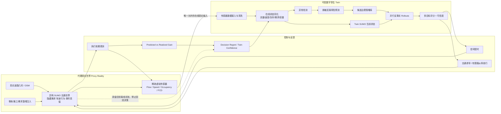

# 《城脉·涟控》竞赛级深度研究与三周落地方案

## 执行摘要

**明确结论：我仍然建议你做《城脉·涟控》，但不是最初那个“SUMO 中检测事故→预测拥堵→跑几个方案→选最优”的版本。**

真正值得投入三周、且更有全国赛竞争力的版本应正式定义为：

> **《城脉·涟控——面向突发事件与模型失配的城市交通可信数字孪生主动治理系统》**

它的核心不是“又做一个交通数字孪生平台”，而是解决一个比普通信号控制、拥堵预测更本质的问题：

> **现实交通永远不会和数字模型完全一致。在稀疏感知、模型失配、突发事件未知的情况下，数字孪生怎样持续校准自己、预测拥堵涟漪、在虚拟世界里先试治理方案，并证明自己作出的决策在“现实”中确实有效？**

我的竞赛判断是：这比“智慧红绿灯”“MARL 信号控制”“交通大模型”“事故检测+大屏”“停车平台”等更适合现在的你。原因不是论文创新性最高，而是它同时满足：

**痛点一眼可懂 + 数字孪生是真的闭环 + 有 AI + 有交通工程 + 有主动控制 + 有漂亮 Demo + 有严格 baseline + 不需要大模型训练 + 3 周可做 + 可以反驳“SUMO 动画不等于数字孪生” + 能形成软件系统而不是论文模型。**

但有四个决定成败的修改必须执行。

第一，**Proxy Reality 和 Digital Twin 不能是完全一样的 SUMO**。真实代理世界与孪生必须在交通需求、随机种子、驾驶参数乃至跟驰模型上存在刻意的失配，Twin 只能看到模拟线圈/FCD 等稀疏观测，否则“高孪生精度”没有说服力。

第二，**在线状态同化必须成为核心技术，不是附属功能**。PTV Optima 等现有工业系统本身就在持续融合现场数据、填补未监测道路状态、预测未来并并行评价干预方案；Aimsun 的实际交通数字孪生也已经做到事件发现、预定义 playbook 和信号控制闭环。因此，“实时仿真+what-if”本身已经不能作为创新点。citeturn23view1turn23view2turn23view3

第三，**增加“决策遗憾 Decision Regret”评价体系**：不仅问“Twin 的速度 RMSE 多小”，而要问：

> Twin 说方案能改善 18%，在隐藏的真实代理世界执行后到底改善了多少？  
> 更重要的是，Twin 选的方案和真正的最优方案差多少？

第四，**10 月 25 日之前必须形成真实可运行的 V1.0 闭环，不要把初赛当概念筛选。** 官方指南明确规定，定向赛道“不设置具体题目”，本届“智慧交通与数字孪生”只是方向；线上初评考察主题相关性、创意新颖性、可行性、社会与经济效益、商业模式与市场前景、作品展现形式。软件类作品还要求提供原创原型/源代码证明。报名及资格审核截至 **2026 年 10 月 23 日 12:00**，作品提交截至 **10 月 25 日 12:00**，决赛为 **12 月 26–27 日**；指南还明确写明项目提交截止后指导教师、队员和作品内容不得调整。citeturn4view0turn5view0turn5view1turn5view2

[第十二届大赛官方参赛指南 PDF（北京理工大学镜像）](https://grd.bit.edu.cn/docs/2026-07/dc32adc8255c4a59a8c1608dbe2a2ca4.pdf)

### 研究中的关键假设

本报告不假定你拥有真实交警信号控制接口、路侧相机、线圈检测器或运营商 FCD；原型采用“**隐藏异构代理现实 + 稀疏虚拟传感器**”作为受控实验平台。

本报告也**不把你之前提供的那段“要求搭建高精度交通数字孪生模型，实现车流实时复刻……”文字视为已核实官方赛题原文**。我在本届官方指南里能确认的是“智慧交通与数字孪生”赛道名称以及“定向赛道不设置具体题目，参赛者自行拟题”。citeturn4view0turn5view0

团队目前是否已报名并通过校方审核，我无法从现有信息判断；这是当前唯一一个必须由你线下确认的 P0 条件。

工程上假定核心演示网络控制在 **约 6–12 个信号交叉口/一个城市走廊级区域**，而不是为了“城市级”三个字强行模拟整个城市。这是我基于三周期限作出的工程设计选择，而非赛事要求。

---

## A–B. 竞赛评审逻辑、往届获奖规律与值得利用的技术趋势

**A. 竞赛评审逻辑与获奖项目规律**

### 官方真正要求什么

本届指南对项目的要求远不止“技术创新”。作品说明本身要求围绕背景、创意、解决方案，并考虑可行性、技术路线、核心技术、社会价值、经济效益、商业模式和市场前景；网络初评直接包含六类评价：**主题相关性、创意新颖性、可行性、社会与经济效益、商业模式与市场前景、作品展现形式**。决赛则进入现场展示、陈述与问答。citeturn4view0turn5view1turn5view2

指南里的技术自评部分还要求说明技术成熟度、国内外竞品/技术比较以及 **3–5 个关键性能指标及提升程度**，并尽量用测试或其他证据支撑。citeturn5view3

这意味着一个很重要的竞赛逻辑：

> **评委不是在找“最复杂的算法”，而是在找“已经长成产品雏形的创新技术方案”。**

### 近三届代表性项目告诉我们的东西

| 届次 | 代表作品 | 成绩 | 值得注意的特征 | 对《城脉·涟控》的启示 |
|---|---|---:|---|---|
| 2023 第九届 | **I-BMS 智慧城市中的新能源安全守护者** | 总冠军 | 有完整 BMS 方案、建模、状态估计、故障诊断/热失控预警，而非单个网络模型 | 冠军级项目通常是“问题—核心技术—系统—可验证结果”的完整链条 citeturn15search2turn15search7 |
| 2023 第九届 | **纵横——全域感知的通用交通智脑引擎** | 全国一等奖 | 直接面向交通全域感知与城市交通智能治理 | “城市交通+平台”可以获高奖，但必须有清晰核心能力，不能只是 dashboard citeturn15search2 |
| 2024 第十届 | **城市路网多模式交通绿波协调信号优化系统** | 全国一等奖 | 针对多交通模式干扰、周期优化、区域协调等具体问题，做的是“一整套优化算法及成套系统” | **算法 + 成套系统**明显比单纯 DRL 信号论文更符合竞赛语言 citeturn16search1turn16search2 |
| 2024 第十届 | **Sameway——基于三维点云空间的城市道路环境安全评价技术** | 全国二等奖 | 激光扫描→高精度三维道路空间→视距检查→标志遮挡评价 | “数字空间真实性 + 明确交通工程痛点 + 专用算法”非常有效 citeturn16search1turn16search2 |
| 2025 第十一届 | **“以盔助行”——基于鬼探头交通事故预警系统的安全头盔设计** | 全国二等奖 | 多传感器、LoRa/V2P、SAN-GAN/LSTM 预测、碰撞风险研判、语音反馈，形成真实用户闭环 | 安全价值高、功能链完整、演示对象具象，容易让非算法评委理解 citeturn16search3 |
| 2025 第十一届 | **“标智眼”——多尺度融合的轻量化交通标志识别系统** | 全国二等奖 | 轻量识别算法被包装为可用系统而非孤立精度表 | 即使核心是视觉算法，也必须产品化和系统化 citeturn15search20 |

2023 年第九届有 2194 支队伍报名、166 支进入决赛；2024 年第十届有 3378 支报名、200 项进入全国总决赛；2025 年第十一届共有 2338 支队伍报名，最终评出一等奖 49、二等奖 143、三等奖 295。citeturn15search8turn16search2turn15search6

因此不要把目标理解成“算法做到 top-1 就够了”。在这种筛选强度下，**能在几分钟内证明自己是完整产品雏形的项目明显更稳**。这是基于官方评分维度和上述获奖项目的竞赛推断，而不是官方公布的权重。

### 我对八个因素的实际优先级

这不是官方权重，而是用于你的三周资源分配：

| 层级 | 因素 | 我的判断 |
|---|---|---|
| **S** | 系统完整度 | 第一优先级。必须能从输入真正跑到输出和反馈，而非模块 PPT |
| **S** | 技术落地性/政府部署逻辑 | 初评直接有“可行性”“商业模式与市场前景” |
| **S** | 创新点 | 必须一句话说清，而且不能只是“用了大模型/数字孪生” |
| **A+** | 数字孪生真实性 | 对本赛道尤其重要；这是区分你和普通交通 AI 项目的关键 |
| **A** | 社会/民生价值 | 初评直接评分，事故、拥堵、应急等问题都很直观 |
| **A** | 技术深度 | 要够，但不能吞噬系统开发时间 |
| **A-** | 视觉展示 | 初赛已有“作品展现形式”，进入决赛后重要性继续上升，但“UI 占 80%”之类说法没有依据 |
| **B+** | 真实数据 | 非独立评分项，却是增强可信度的重要证据；真实数据并不等于必须接真实交通局系统 |

我尤其**不建议**三周时间大量投入一篇新 MARL/Transformer 论文式算法。华南理工 2024 一等奖项目之所以值得参考，不在于“信号优化”这个题目本身，而在于它把交通工程问题、算法和成套系统统一起来。citeturn16search1turn16search2

**B. 2024–2026 值得利用的新技术趋势**

### 最值得借的，不是最大模型，而是“可信闭环”

PTV Optima 的公开产品能力已经包括多源实时交通数据融合、未监测道路状态补全、交通预测、事故识别、并行评价替代治理策略、实时信号控制等；其 York 部署用滚动 15 分钟模型持续吸收实时数据，并测试不同信号方案。citeturn23view1turn23view3

Aimsun 在 Tees Valley 的 2025 交通数字孪生案例进一步展示了“发现扰动→调用预批准 playbook→直接执行信号干预”的自动化闭环；公开结果称约 600 次策略部署的模型化反事实比较中，针对性措施对应的平均旅行时间减少约 13.7%。这里需要注意，这是供应商公开的项目分析，不应被视为对我们项目算法的独立 benchmark。citeturn23view2

因此 2026 年做比赛时：

**“数字孪生能做 what-if”已经不新。**

真正值得借的趋势是：

> **实时同化 + 模型不确定性 + 预测 + 反事实决策 + 现实反馈 + 决策可信度。**

这恰恰是《城脉·涟控》应该占的位置。

### 时空基础模型：可以“借势”，不要成为工程依赖

OpenCity 在 2024 年提出开放的交通时空基础模型，通过 Transformer 和图网络学习不同城市中的时空规律，重点之一是跨区域/跨城市的 zero-shot 泛化，并开源了代码。citeturn19search0turn19search4

它说明 2024–2026 的一个明显方向：

**交通预测正在从“一个城市训练一个小模型”走向跨区域预训练、基础模型和泛化。**

但我**不建议在《城脉·涟控》主链中强接 OpenCity**。你的 SUMO 事件网络和其训练分布不一致，三周内为了让一个 foundation model 输出几条更漂亮的预测曲线，收益很可能小于状态同化、控制闭环和实验可信度。

正确用法是：

> 将 OpenCity/DCRNN 作为“技术储备或真实数据预测验证”，不是主控制器。

### LLM / 多智能体信号控制：热点很强，但赛题风险也很高

LLMLight 已经探索让大语言模型直接充当交通信号控制 agent；CoLLMLight 的官方实现进一步将合作式 LLM agent 用于网络级交通信号控制，并已被 ICLR 2026 接收。citeturn19search3turn19search7turn19search38

这说明“LLM + 红绿灯”到 2026 已经**不是自动等于创新**。

对三周竞赛来说，大模型最合理的位置不是：

> LLM 每 30 秒决定哪个灯变绿。

而是：

> **把交通工程模型产生的结构化结果转换成可审计的治理解释、约束检查或异常场景建议。**

甚至这个功能都应该放到加分版，而不是 MVP。

### 世界模型：2026 看起来非常新，但不适合成为主工程

CVPR 2025 的 SceneDiffuser++ 将城市级交通仿真推进到生成式世界模型方向，目标包括地图、动态交通参与者和信号状态的长时间生成。citeturn19search5turn19search9

这非常“2026”，但对你的项目来说：

**引用它说明趋势即可，千万不要试图三周复现世界模型。**

它会把你从“比赛交付”拖回“重模型研究”。

### 多智能体控制仍然重要，但不值得重新训练大系统

CityFlow 专门面向大规模城市路网控制，支持 Python 接口、信号控制和可复现实验；CoLight 等公开研究已经证明图结构多智能体信号协调是一个高度成熟的研究方向。citeturn21search0turn19search37

所以：

> **MARL 可以作为一个候选方向或 baseline，不应成为《城脉·涟控》的创新中心。**

### 最适合三周的技术优先级

**现在就用：**

在线状态同化、图结构拥堵传播、轻量异常检测、物理仿真反事实、策略 playbook、并行 rollout、可信度/Decision Regret。

**有余力再用：**

小型 GCN-GRU、预训练交通模型、CARLA/SUMO 联合视觉展示、LLM 自然语言解释。

**不建议：**

从零训练交通大模型、城市世界模型、大规模 MARL、VLM/VLA 端到端交通控制。

---

## C. 可直接利用的数据、仿真与开源资源

最重要的资源判断不是“有没有”，而是**三周里是否值得接**。

| 资源 | 能直接提供什么 | 3 周可用性 | 在本项目中的建议 |
|---|---|---:|---|
| [SUMO](https://sumo.dlr.de/docs/index.html) | 开源微观连续交通仿真、大规模网络、多交通方式 | **P0，立即用** | 核心 Proxy + Twin；不要同时维护 SUMO、CityFlow、CARLA 三套核心逻辑 citeturn17search1 |
| [SUMO OSM Web Wizard](https://sumo.dlr.de/docs/Tutorials/OSMWebWizard.html) | 从 OSM 选区域，自动生成路网和初始交通场景 | **P0** | Day 1 就拿真实道路几何建立 6–12 路口场景 citeturn21search2turn21search5 |
| [TraCI Save/Load](https://sumo.dlr.de/docs/Simulation/SaveAndLoad.html) | 保存/恢复仿真状态 | **P0** | 从同一 Twin 快照分叉 A/B/C/D 多个未来治理方案；注意 `--save-state.rng` 和 route/flow 恢复问题 citeturn17search0turn17search4 |
| [TraCI Calibrator](https://sumo.dlr.de/docs/TraCI/Change_Calibrator_State.html) | 在线修改某位置流量和速度 | **P0** | 孪生在线需求校准的现成执行器，不必自己魔改 SUMO 内核 citeturn18search0 |
| [TraCI Traffic Light](https://sumo.dlr.de/docs/TraCI/Change_Traffic_Lights_State.html) | 在线换相位、时长、信号程序 | **P0** | 执行干预策略 citeturn18search1 |
| [SUMO Routing/TraCI reroute](https://sumo.dlr.de/docs/Simulation/Routing.html) | `rerouteTraveltime`、`findRoute`、临时封路/绕行 | **P0** | 模拟导航诱导和事故绕行；应加入“驾驶员服从率”而非让所有车辆无条件听从 citeturn18search2turn18search4 |
| [SUMO Emissions](https://sumo.dlr.de/docs/Models/Emissions.html) | CO₂、CO、NOx、PM、燃油、电耗等 | **P0/P1** | 不需外接排放模型即可加入绿色指标 citeturn17search3turn17search6 |
| [OpenStreetMap](https://www.openstreetmap.org/) | 开放道路网络数据 | **P0** | 真实道路拓扑来源；视频/产品中注意 OSM attribution citeturn21search3turn21search8 |
| [香港运输署战略/主要道路交通数据](https://data.gov.hk/en-data/dataset/hk-td-sm_4-traffic-data-strategic-major-roads) | 流量、速度、占有率；原始数据分钟级更新并提供历史数据 | **P0/P1，非常推荐** | 做“真实城市数据适配/回放”证明，远比硬找中国内地难调用 API 稳妥 citeturn22search9 |
| [香港智慧灯柱交通检测数据](https://data.gov.hk/en-data/dataset/hk-td-tis_33-traffic-data-traffic-detectors-installed-at-smart-lampposts) | 流量、速度、占有率，分钟级 | **P1** | 和你的“稀疏路侧感知”叙事非常契合 citeturn22search16 |
| [UTD19](https://utd19.ethz.ch/) | 40 城市、23541 个固定检测器，主要是流量+占有率/速度 | **P1** | 用于验证传感器特征和时空预测；需要注册，不适合拿来强行复刻某一个 OSM 网络 citeturn20search1turn20search4 |
| [DCRNN 官方实现](https://github.com/liyaguang/DCRNN) | METR-LA、PEMS-BAY、预训练模型和 demo | **P1** | 要交通预测模块时可直接展示真实数据预测；代码较老、TensorFlow 依赖老，**不要放入主链** citeturn20search0 |
| [OpenCity](https://github.com/HKUDS/OpenCity) | 2024 时空基础模型开源代码 | **P2** | 作为“基础模型扩展/真实数据预测”的加分功能，不是 MVP citeturn19search0turn19search4 |
| [CityFlow](https://cityflow-project.github.io/) | 大规模城市交通仿真、Python 信号控制、可复现实验 | **P1/P2** | 如果最终方向变成大规模多智能体信号控制再用；《城脉》核心不需要切换过去 citeturn21search0 |
| [CARLA](https://carla.readthedocs.io/) | 高视觉真实度车辆/行人/传感器环境；支持 OSM 流程和 SUMO 协同 | **P2，加分版** | 只负责全国赛 Hero Shot / 局部事故视觉，不承担核心实验 citeturn21search1turn21search7turn21search25 |
| CoLLMLight / LLMLight | 大模型合作式信号控制代码 | **P2/P3** | 只能作为趋势或未来扩展，不要三周重构项目去追热点 citeturn19search3turn19search38 |

### 我最推荐的数据组合

不要试图得到一套“所有东西都来自同一个真实城市”的完美数据。

三周最稳妥的是三层证据：

**第一层：真实几何**

OSM → SUMO 城市道路。

**第二层：真实传感器分布/量纲**

香港运输署或 UTD19 的速度、流量、占有率数据 → 证明你的感知接口和状态变量是真实交通管理常用形式。香港开放数据甚至提供分钟级交通流、速度、占有率。citeturn22search9turn22search16

**第三层：受控反事实实验**

隐藏 Proxy SUMO → 才能真正回答“同一个事故如果不治理会怎样”，这是现实交通数据几乎无法给你的 ground truth。

这种组合比假装“我们的系统已经接入某城市交通局”更可信。

---

## D–E. 八个候选方向与竞赛横向评分

**D. 八个明显不同的候选主题**

### 候选全景

| 主题 | 城市痛点 / 用户 | 真正“孪生”什么 | AI / 预测 / 控制 | Demo 与量化指标 |
|---|---|---|---|---|
| **城脉·涟控：突发事件可信孪生主动治理** | 事故、施工、异常停车导致拥堵级联；交警/交通运行中心 | 路网流量、速度、队列、需求、信号状态、事件造成的有效容量以及模型置信度 | 异常检测 + 拥堵传播预测；在线同化；信号/绕行联合 what-if | 突发事故→自动发现→预测回溢→4 策略推演→执行；旅行时间、延误、排队、吞吐、CO₂、Decision Regret |
| **信枢·群控：多智能体区域信号孪生** | 路口孤立控制、干线波动；交警信控部门 | 多路口相位、车道队列、到达流和相邻交叉口耦合 | MARL/GNN/LLM agent；网络级信号控制 | 高峰突发需求→各智能体协调；延误、队列、停车次数、吞吐 |
| **盲区·守望：复杂路口弱势交通参与者冲突孪生** | 鬼探头、非机动车、行人转弯冲突；交警/道路安全部门 | 轨迹、冲突区、遮挡、信号状态、TTC/PET 风险场 | YOLO/轨迹预测/冲突预测；动态保护相位/车速警示 | 汽车与骑行者形成潜在冲突→提前预警→动态相位；TTC、PET、冲突次数、车辆延误 |
| **急脉·绿廊：应急车辆网络级协同通行孪生** | 救护车/消防车穿越拥堵城区；应急部门/交警 | 应急车位置、一般交通流、信号、队列与候选路径 | ETA/拥堵预测；路径+信号联合优化 | 救护车突然进入→规划动态绿廊→普通交通自动恢复；应急旅行时间、一般车辆额外延误、恢复时间 |
| **韧路·风暴：极端天气交通韧性数字孪生** | 暴雨积水、道路封闭、事故集中发生；交通局/应急局 | 道路通行能力随天气/积水变化的时空网络 | 风险预测、路段失效传播、疏散/绕行优化 | 突发暴雨导致若干路段容量下降/封闭→预测失效→自动疏导；受困车辆、旅行时间、疏散完成率 |
| **公交·优脉：动态公交优先与全交通公平孪生** | 公交晚点和优先信号对社会车辆的副作用；交通局/公交集团 | 公交位置、晚点、客流代理、一般车辆、信号 | 到站/延误预测；动态 Transit Signal Priority | 公交晚点→请求优先→系统判断是否放行；公交延误、社会车延误、乘客加权旅行时间、CO₂ |
| **泊链·净街：路缘停车—巡游拥堵耦合孪生** | 找车位巡游、路边停车排队和装卸侵占车道；城管/停车运营商 | 停车位占用、巡游车辆、路缘空间、周边交通流 | 占用率预测；停车诱导/动态路缘功能分配 | 活动结束停车需求激增→巡游拥堵→系统分配车位/路缘；找位时间、巡游里程、排队、道路延误 |
| **碳路·协控：交通效率—排放双目标数字孪生** | 缓堵策略未必最低排放；交通局/生态环境部门 | 微观车辆运行、速度轨迹、信号、排放状态 | 时空流量预测；信号/绕行多目标优化 | 高峰→分别展示最短延误和低碳策略→Pareto 选择；延误、CO₂、NOx、停车次数 |

SUMO 原生可以在线控制信号、重路由并输出车辆/道路 CO₂ 等排放，因此候选一、二、四、六、八都无需额外购买商业仿真器即可完成关键闭环。citeturn18search1turn18search2turn17search3

### 各候选的竞赛现实性

**城脉·涟控**

现实→数字映射采用稀疏线圈/FCD 的流量、速度、占有率，而不是直接把所有车辆真值复制过去。AI 负责异常和影响范围预测，Twin 负责物理反事实验证，策略层负责 signal/rerouting 联合治理。GPU 低到中。难度 **中高但结构可控**。

评委可能喜欢它，是因为从“发现问题”到“治理以后城市变好”链路极其直观，而且真正有闭环。

最大的质疑就是：

> “这不就是 Aimsun/PTV 已经有的实时交通数字孪生吗？”

答案不能回避。PTV Optima 确实已经公开提供实时多源数据、预测、并行 mitigation scenario 和信号控制；Aimsun 的实际项目也已经自动调用 playbook。citeturn23view1turn23view2

因此你的创新必须放在**稀疏感知/模型失配下的可信度、自校准和 Decision Regret**，而不是“我能跑 what-if”。

**信枢·群控**

现成 CityFlow、CoLight、LLMLight/CoLLMLight 资源最多。GPU 中等，三周实验也最容易。

然而恰恰因为资源过多，**红绿灯控制已经高度同质化**。2024 本大赛甚至已有全国一等奖的多模式路网绿波协调信号系统。citeturn16search1turn19search38

除非你能提出非常不同的治理对象，否则不建议以它为主赛题。

**盲区·守望**

技术表现力最强：YOLO、轨迹预测、TTC/PET、CARLA、俯视冲突热力图都很好看；弱势交通参与者的民生和安全价值也极强，2025 大赛已经证明“鬼探头+智能头盔”这一安全痛点能获得全国二等奖。citeturn16search3

但问题也明显：评委会追问“摄像头从哪里来、轨迹误差是多少、遮挡情况下如何保证安全”。没有真实路侧相机和标定系统时，最核心的感知真实性反而成为短板。

**急脉·绿廊**

是最强备选之一。

它可以完整展示：

救护车进入 → 路网预测 → 路径选择 → 前方信号提前清空 → 通过后恢复。

几乎不需要复杂大模型，实验也极易量化。

弱点是创新性略逊于可信孪生，而且容易被理解成“应急车辆信号优先系统升级版”。

**韧路·风暴**

从 2026 竞赛视觉和社会价值上很强：暴雨、道路失效、疏散具有明显“韧性城市”叙事。

但它最大的风险是需要解释：

> “积水 20 cm 到底对应道路容量下降多少？”

如果没有可靠水文/交通耦合模型，容易变成随意设置 capacity factor 的剧情演示。

**公交·优脉**

落地价值非常高，而且 Aimsun 的 Tees Valley 数字孪生案例就展示了交通数字孪生和公交可靠性改善的真实运营价值。citeturn23view2

三周可实现，且天然包含绿色交通。

弱点是“动态公交优先”本身不是新概念，需要用乘客公平性/网络副作用和可信孪生重新包装。

**泊链·净街**

比普通“智慧停车系统”好得多，因为真正研究的是**停车搜索如何反过来制造道路拥堵**，而不是车位预约 App。

但停车占用/车辆找位行为的数据和微观模型准备工作相对繁琐，三周风险明显高于前几个方向。

**碳路·协控**

SUMO 已原生支持 CO₂、CO、NOx、PM 等输出，因此实验最容易。citeturn17search3turn17search6

但“延误+排放多目标优化”很容易成为普通优化项目，除非核心痛点更强，否则全国赛记忆点弱于事故、应急和安全。

**E. 候选主题横向评分**

全部为我的**竞赛决策评分，不是官方成绩预测**。10 分最佳。“数据”栏按**数据可得性**评分，即分越高越容易。

| 项目 | 落地 | 孪生真实性 | 创新 | 民生 | 安全 | 绿色 | 精细治理 |
|---|---:|---:|---:|---:|---:|---:|---:|
| **城脉·涟控** | **9.2** | **9.5** | **9.2** | 9.2 | 8.3 | 7.5 | **10** |
| 信枢·群控 | 9.0 | 8.0 | 6.3 | 8.0 | 6.0 | 8.0 | 9.2 |
| 盲区·守望 | 7.3 | 7.5 | 9.0 | **10** | **10** | 6.0 | 8.0 |
| 急脉·绿廊 | 9.2 | 8.5 | 8.2 | **10** | 9.8 | 6.5 | 9.0 |
| 韧路·风暴 | 8.0 | 8.0 | **9.4** | **10** | 9.0 | 8.0 | 9.0 |
| 公交·优脉 | 9.0 | 8.4 | 7.5 | 9.2 | 7.5 | **10** | **9.5** |
| 泊链·净街 | 8.0 | 7.5 | 8.0 | 8.7 | 6.5 | 8.5 | 9.0 |
| 碳路·协控 | 9.0 | 8.0 | 7.0 | 8.0 | 6.0 | **10** | 9.0 |

| 项目 | 视觉 | 实验易做 | 数据 | 三周 | 系统完整 | 技能匹配 | **国奖潜力** |
|---|---:|---:|---:|---:|---:|---:|---:|
| **城脉·涟控** | **9.5** | **10** | 8.5 | **9.0** | **10** | **10** | **9.4** |
| 信枢·群控 | 8.0 | **10** | 9.0 | 8.5 | 9.0 | **10** | 7.2 |
| 盲区·守望 | **10** | 8.0 | 7.0 | 6.5 | 8.0 | **10** | 8.4 |
| 急脉·绿廊 | 9.4 | **10** | 9.0 | **9.2** | 9.2 | 9.3 | 8.8 |
| 韧路·风暴 | **10** | 8.5 | 6.0 | 7.5 | 9.0 | 9.0 | 8.9 |
| 公交·优脉 | 8.5 | 9.5 | 8.0 | 9.0 | 9.0 | 9.0 | 8.2 |
| 泊链·净街 | 8.5 | 8.0 | 6.5 | 7.5 | 8.5 | 8.0 | 7.7 |
| 碳路·协控 | 9.0 | **10** | 9.0 | 9.0 | 9.0 | 9.0 | 7.8 |

我会重点反驳自己的前三个诱惑：

**为什么不选“韧路·风暴”？**

它可能比城脉更“新”，但你必须建立天气/积水→道路容量衰减的可信映射。三周里这一条科学证据链比交通事故容量变化更容易被攻击。

**为什么不选“急脉·绿廊”？**

它是最稳的第二名，但核心技术会逐渐退化成 routing + emergency signal preemption。很好做、很好演，却没有“可信数字孪生”这个可形成研究生级技术壁垒的中心问题。

**为什么不选“盲区·守望”？**

视觉最炫，但真实感知和传感器标定是核心。你没有必要为了一个交通数字孪生赛，在最后三周把风险最大的部分放在模拟路侧视觉真实性上。

因此第一名仍是：

> **城脉·涟控。**

---

## F–G. 最终唯一推荐主题、核心创新与完整数字孪生闭环

**F. 最终项目定义**

### 正式名称

> # 《城脉·涟控——面向突发事件与模型失配的城市交通可信数字孪生主动治理系统》

建议 Logo/副标题中再出现一句：

> **让数字孪生不只“预测未来”，更证明自己的决策可信。**

### 三十秒介绍

> 城市事故真正危险的不只是事故点，而是几分钟后沿路网产生的排队回溢和拥堵涟漪。《城脉·涟控》构建一个持续从稀疏路侧感知中自我校准的交通数字孪生，在突发事件发生后自动识别异常、预测拥堵传播，并在虚拟城市中并行推演信号优化、交通诱导等治理方案，再将最优方案反馈给交通系统。不同于传统数字孪生只报告预测结果，我们进一步比较“孪生预测收益”和“现实执行收益”，量化每次治理决策的可信度和决策遗憾，实现真正可验证的交通治理闭环。

### 最核心的一句话创新

> **首次把“数字孪生的决策是否可信”作为交通治理闭环中的显式变量：在稀疏感知和模型失配下持续同化交通状态，用反事实仿真选择干预，再以代理现实中的实际治理效果计算 Decision Regret 并反馈孪生可信度。**

“首次”在正式参赛材料中我建议改成更审慎的：

> **“提出一种……”**

除非后续完成系统性文献检索后能够严格证明优先权。PTV/Aimsun 已公开具备许多邻近能力，因此不要做未经证明的“全球首创”宣称。citeturn23view1turn23view2

### 五个次级创新点

**异构 Proxy–Twin 双世界验证协议。**  
隐藏代理城市和 Twin 使用不同需求、驾驶行为、随机种子甚至跟驰参数；算法不能读取 Proxy 全量车辆状态，使数字孪生从“复制仿真”变成“从有限传感重建交通”。

**稀疏感知下的在线孪生同化。**  
通过流量、速度、占有率、少量 FCD，不断修正路段状态、入口需求和事件造成的有效容量。SUMO Calibrator 本身支持在线设置流量和速度，可作为工程执行接口。citeturn18search0

**拥堵涟漪预测和物理反事实分工。**  
轻量图预测器判断哪些道路最可能发生回溢并缩小策略搜索范围；真正决定是否下发策略的，是 Twin 中可解释的交通仿真 rollout。AI 不取代交通物理。

**受约束交通治理 playbook。**  
不让 RL 随意改变红绿灯，而采用“信号时制调整、局部交通诱导、联合控制”等现实交通管理可理解的 action library。Aimsun 的真实数字孪生案例也采用预批准 playbook，说明这种工程形式与真实交通运营逻辑兼容。citeturn23view2

**Decision Regret + Gain Calibration。**  
评价数字孪生不止用 RMSE，还评价它有没有因为模型误差选错治理方案。

### 商业/政府落地定位

不要写：

> “替代 Aimsun、PTV，打造下一代城市交通操作系统。”

这是不可信的。

写：

> **面向中小城市、园区、校园、交通走廊和既有交通控制中心的轻量级可信交通决策中间件。**

输入适配既有：

摄像机结构化流量 → 线圈/雷达 → FCD → 信号日志 → 事件数据。

输出可以先是：

**治理建议 + 可信度 + 可解释效果预测**

随后才是经审批后：

**信号方案调用 / VMS 导行 / 导航诱导 API。**

商业模式写成：

**软件授权/私有化部署 + 场景建模与校准服务 + 运维与策略库服务。**

这至少正面回应本届明确评分的“商业模式与市场前景”。citeturn4view0turn5view2

**G. 完整系统架构与数字孪生闭环**

### 双世界系统架构



SUMO 支持通过 TraCI 修改信号状态/信号程序和相位时长，也能计算实时重路由；因此控制链条可以直接用公开 API 完成，不需要自己改交通仿真器。citeturn18search1turn18search2

### 最关键的“信息防火墙”

这是我建议你写进说明书方法章节的一张表。

| Proxy 中存在的信息 | 算法能不能看 | 说明 |
|---|---:|---|
| 每辆车真实位置 | **不能** | 除非属于抽样 FCD |
| 事故真实 flag | **不能** | 系统必须从异常传感自行发现 |
| 未来真实 OD | **不能** | 严禁未来泄漏 |
| 全路网真实流量 | **不能** | 仅有布设传感器路段 |
| 线圈流量/速度/占有率 | **能** | 正常数字孪生观测 |
| 5–10% FCD 样本 | **能** | 可选 |
| 交通信号实际状态 | **能** | 现实中合理获取 |
| Proxy 全真值 | **仅评测程序能** | 只计算 ground-truth twin error / oracle，禁止回流 |

这一步非常重要。

否则评委一句：

> “你为什么不直接读 SUMO 车辆位置？”

整个“数字孪生状态估计”就没了。

### Proxy 与 Twin 如何故意不一样

建议初版这样设置：

**共同的：**

道路几何、信号物理连接关系。

**不同的：**

Proxy 使用真实隐藏 demand；

Twin 初始 demand 故意 ±10–20% 偏差；

驾驶员期望速度、反应时间、随机性不同；

route choice 不完全一致；

传感器加入测量噪声；

部分路段完全没有传感器；

事故在 Proxy 发生，Twin 不直接收到事故 label。

进阶版本再让二者采用不同跟驰参数/模型。

这样你的任务才是：

> **“从不完美模型逐渐追上现实”。**

### 在线状态同化：三周可做的版本

不要第一天就上 Ensemble Kalman Filter + differentiable simulator。

推荐两层方案：

**观测状态层**

每 30 秒形成每条可观测边：

\[
z_e(t)=[q_e(t),v_e(t),o_e(t),n^{halt}_e(t)]
\]

即流量、速度、占有率、停车车辆代理量。

未布传感器路段通过邻接关系、流守恒和 Twin 仿真状态得到估计。

**模型校准层**

计算 Proxy 传感观测与 Twin detector 的残差：

\[
r_t=y_t-\hat y_t
\]

然后滚动更新：

入口 demand multiplier；

关键走廊容量/速度 correction；

需要时调整事件影响候选。

SUMO 的 calibrator API 可以在线设置某位置的流量和速度，为这种轻量校准提供直接接口。citeturn18search0

第一版完全可以使用：

**EWMA/递推最小二乘 + 有界参数优化**

而不是深度学习。

这反而更容易答辩：

> “我们没有让神经网络偷偷学一个仿真器，而是在交通流物理框架内持续校正需求与容量。”

### AI 模块应该做什么

我建议 AI 只有两个真正任务。

**异常检测**

MVP：

rolling residual + CUSUM / robust z-score。

完整版：

XGBoost / LightGBM / Isolation Forest，输入最近 1–3 分钟：

速度下降率、占有率增长、流量变化、上下游不一致、Twin residual。

输出：

`P(event)` 和疑似受影响 corridor。

**拥堵涟漪预测**

MVP：

基于队列压力、剩余存储容量和拓扑的图传播模型。

加分：

2 层 GCN + GRU，小网络，在 SUMO 生成的几千个时间窗上训练。

输出不是整个未来世界，而是：

> 哪些边在 5/10 分钟内有排队回溢风险。

这避免和“do-nothing Twin rollout”功能重复。

### 反事实决策

发生事件后，在 Twin 当前状态保存 snapshot。

SUMO 明确支持保存/快速加载 simulation state；如果要严格保持随机过程，还可保存 RNG 状态。文档同时提醒，增量加载的 flow/route 在恢复状态时需要特别处理，所以你应从 Day 2 起固定 route input 设计，不要最后才踩这个坑。citeturn17search0turn17search4

然后并行分支：

**A0：不处理**

**A1：局部信号响应**

**A2：交通诱导**

**A3：信号 + 诱导**

可选 A4：

上下游 gating / 协调绿波。

每个 Twin 分支向前跑 5–10 个仿真分钟。

决策目标不要过度复杂：

\[
J(a)=
0.45D+
0.25Q+
0.15S+
0.10E+
0.05C
\]

其中：

\(D\)：标准化总延误  
\(Q\)：最大/平均排队  
\(S\)：回溢风险  
\(E\)：CO₂  
\(C\)：控制动作代价

这些权重是**工程默认值，不是科学真理**，说明书里应加一次敏感性分析。

信号安全约束作为 hard constraint，不进入加权求和。

### 数字孪生完整闭环

必须在答辩中原样说清楚：

> **现实交通状态**  
> ↓  
> **稀疏路侧感知 / FCD**  
> ↓  
> **数字孪生状态更新与在线校准**  
> ↓  
> **异常识别与拥堵涟漪预测**  
> ↓  
> **多候选治理策略反事实仿真**  
> ↓  
> **可信度约束下选择方案**  
> ↓  
> **信号控制 / 交通诱导**  
> ↓  
> **现实交通状态改变**  
> ↓  
> **传感器重新观测**  
> ↓  
> **实际收益与预测收益比较 / Decision Regret**  
> ↓  
> **再次更新 Twin**

这才是你整个项目最重要的一张闭环图。

---

## H–I. 全国赛 Demo、实验设计与 Decision Regret

**H. 三到五分钟 Demo 剧本**

Demo 目标不是让评委欣赏软件，而是回答四个问题：

> **发生了什么？**  
> **AI 看到了什么？**  
> **系统做了什么？**  
> **城市因此改善了多少？**

### 场景开场

**0:00–0:25**

画面左右分区：

左侧：**城市代理现实**

真实 OSM 路网，车辆运行，路段颜色反映真实交通状态。

右侧：**Digital Twin**

只有从有限传感器重建出的交通态势。

顶部：

`Twin Fidelity 91.8% / 当前状态：正常`

底部时间序列：

Proxy detector vs Twin detector。

你主动告诉评委：

> “两套系统并不是同一个仿真。左侧代表隐藏现实世界，右侧孪生只能获得 25% 路段传感器和少量浮动车信息。”

这句话非常值钱。

### 突发问题

**0:25–0:50**

点击：

**“注入突发事故”**

主干道一车道受阻。

Proxy 左侧：

事故车辆/封闭图标出现。

但 Twin **不能直接收到 accident=true**。

几十个仿真秒后：

速度下降；

占有率上升；

上下游流量失衡。

界面弹窗：

> **异常概率 94%**  
> 疑似容量骤降：XX路段  
> 检测延迟：47 s

### 数字孪生同步与未来风险

**0:50–1:25**

Twin 原先与现实产生偏离：

`Speed residual ↑`

同化系统开始修正。

显示：

> Before assimilation: Speed MAE 8.3 km/h  
> After assimilation: 3.1 km/h

然后地图出现“拥堵涟漪”：

红色不是当前拥堵，而是：

`预计 5 min 后`

`预计 10 min 后`

几个上游路口出现倒计时：

> **预计 7.2 min 后发生 queue spillback**

旁白：

> “当前事故本身只影响一条路段，但系统判断 7 分钟后会回溢至两个上游交叉口。”

### Twin 并行试方案

**1:25–2:10**

界面同时出现四张卡：

| 方案 | 预测总延误 | 最大排队 | CO₂ | 综合评分 |
|---|---:|---:|---:|---:|
| 不干预 | 100% | 100% | 100% | 1.00 |
| 信号调整 | -10.8% | -14.2% | -6.2% | 0.88 |
| 绕行 | -13.6% | -11.5% | -4.8% | 0.85 |
| **联合策略** | **-18.7%** | **-26.4%** | **-9.1%** | **0.77** |

数字可以预先实验得到；现场不能写死成虚假“实时结果”。

画面旁边让 4 个 mini-rollout 快速播放。

选出：

> **联合策略**  
> Twin predicted gain：18.7%  
> Confidence：High

### 控制下发

**2:10–2:45**

地图显示两个动作：

上游两个路口调整绿灯配时；

部分车辆被引导进入备用路线。

这里不要让所有车 100% 服从。

比如：

> Guidance penetration：50%  
> Compliance：70%

这样更像现实部署。

TraCI 可以直接修改信号程序/相位并触发车辆重路由。citeturn18search1turn18search2

### 城市反馈

**2:45–3:25**

让观众看到：

不治理的 shadow baseline：

队列继续回溢。

治理世界：

排队开始消散。

最终出现大数字：

> 平均旅行时间 **↓ 15.4%**  
> 总延误 **↓ 16.1%**  
> 最大排队 **↓ 23.7%**  
> 拥堵消散时间 **↓ 31.2%**  
> CO₂ **↓ 7.4%**

这些数字必须来自你最终跑出的真实实验，不能提前当作项目事实。

### 最后一击：可信度

**3:25–4:00**

屏幕显示：

Twin predicted gain：

**18.7%**

Proxy realized gain：

**16.1%**

Gain Calibration Error：

**2.6 percentage points**

Oracle best：

**17.0%**

Our Decision Regret：

**0.9 pp / normalized XX**

然后一句：

> **“传统交通数字孪生告诉管理者应该怎么做；城脉·涟控进一步告诉管理者：这次建议到底有多可信。”**

这就是整个项目的记忆点。

### Demo UI 建议

参考 PTV Optima 的不是配色，而是**信息结构**：实时状态、预测、候选方案、KPI、触发器和决策工作流被放在同一个运营逻辑里。PTV 的公开产品页面直接展示了这种“监测—预测—scenario evaluation—workflow”的结构。citeturn23view1

[Aimsun Tees Valley Digital Twin 案例](https://www.aimsun.com/latest/press-release-tees-valley-digital-twin/)也适合参考“热点—playbook—真实治理结果”的叙事形式。citeturn23view2

推荐你自己的界面结构：

**左 60%：地图**

路网实时速度色带；

车辆点；

事故位置；

传感器位置；

当前拥堵；

未来拥堵涟漪虚线/透明层。

**右上：事件解释**

异常类型、置信度、预计扩散时间。

**右中：4 个方案卡**

预测改善、风险、执行动作。

**右下：Before vs After**

6 个最重要 KPI。

不要做二十多个仪表盘。

### 预计算 fallback

可以准备：

**真实在线 Demo** + **预先录制/预计算备份**。

但备份画面必须明确标：

> “预计算回放 / 演示备份”

不要假装在线跑。

**I. 核心实验与评价指标**

### 实验组别

建议只做四套方法：

**B0 — No Intervention**

检测到事故但什么也不做。

**B1 — Rule-Based**

速度/占有率超过阈值 → 固定的事故信号/绕行策略。

**B2 — Static Twin**

使用数字孪生 rollout，但**没有在线状态同化**。

**OURS — 城脉·涟控**

在线同化 + 风险预测 + counterfactual rollout + 联合控制。

另加：

**Oracle Upper Bound**

允许评测程序读取 Proxy snapshot 并对所有策略逐一执行，找到代理世界真正最优 action。

Oracle **不能进入在线决策**，只用于测 Decision Regret。

### Twin 真实性实验

首先必须证明：

> “我的 Twin 不是看起来像，而是真的能在信息受限下跟踪 Proxy。”

做三档传感覆盖：

10% / 25% / 50%。

三档模型失配：

Low / Medium / High。

比较：

**No Assimilation vs Ours Assimilation**

指标：

\[
MAE_v=\frac{1}{N}\sum|v^{Twin}-v^{Proxy}|
\]

速度 MAE；

流量 MAE/MAPE；

queue length RMSE；

关键走廊 arrival-flow error。

最终图最好做成：

**Assimilation error over time**

事故一发生误差突然上升，随后同化把误差拉回来。

这张图非常能解释“数字孪生为什么不是普通 SUMO”。

### 事件检测实验

事件可以只做三类：

**车道阻塞**

**有效容量骤降**

**局部需求激增**

指标：

Precision / Recall / F1；

False Alarm Rate；

Detection Delay。

不要为了论文规模做十种事故。

### 涟漪预测实验

预测目标不是精确每辆车位置。

定义：

未来 5/10 min 内是否发生：

`queue > threshold`

或：

`occupancy / halting > threshold`

于是指标很简单：

Impacted-edge Precision；

Impacted-edge Recall；

F1；

Time-to-spillback MAE。

### 交通治理核心实验

推荐场景矩阵：

**3 个事故位置/类型 × 2 个需求水平 × 5 个随机种子**

= 30 个场景。

每个场景：

4 个主要方法。

共：

**120 个主实验 run**

而不是之前那种 900-cell 级矩阵。

对于小型 SUMO 网络，这在三周原型中更现实。

核心指标：

**平均旅行时间**

\[
ATT=\frac1N\sum_i(T_i^{arrive}-T_i^{depart})
\]

**总延误**

实际旅行时间相对自由流旅行时间的差。

**最大/平均排队长度**

**吞吐量**

固定时间内完成出行车辆数。

**事故后拥堵消散时间**

路网关键 KPI 回到事故前阈值范围所需时间。

**CO₂**

直接使用 SUMO emission output；其官方输出支持车辆级和 edge/lane 级 CO₂ 等指标。citeturn17search3turn17search6

### Decision Regret：建议正式这样定义

这是本项目最重要的实验指标之一。

设综合成本越低越好。

Twin 对选中策略 \(a^*\) 预测的收益：

\[
\hat G=
\frac{
J_T(a_0)-J_T(a^*)
}{
J_T(a_0)
}
\]

其中 \(a_0\) 是不干预。

在隐藏 Proxy 中，从同一时刻 snapshot 建立两个**只用于评测**的 shadow world：

一个执行 no-action；

一个执行 \(a^*\)。

真实收益：

\[
G=
\frac{
J_P(a_0)-J_P(a^*)
}{
J_P(a_0)
}
\]

于是：

**收益校准误差**

\[
E_{gain}=|\hat G-G|
\]

这个指标回答：

> “Twin 说改善 20%，实际上是不是只有 5%？”

更严格的**决策遗憾**定义为：

\[
R_{decision}
=
\frac{
J_P(a^*)-\min_{a\in A}J_P(a)
}{
J_P(a_0)
}
\]

这里 \(\min J_P(a)\) 是只在离线评测中让真实代理世界把所有候选策略试一遍得到的 oracle。

如果：

Twin 选择 D；

但 Proxy 真正最优是 C；

则系统因 Twin 模型错误造成的决策损失被直接量化。

这比只报告：

> speed RMSE = 2.5 km/h

更能回答交通管理者真正关心的问题：

> **“模型这点误差会不会让我做错决定？”**

### 最有价值的消融实验

只做三个：

**OURS – Assimilation**

证明在线状态校准有价值。

**OURS – Ripple Predictor**

证明预测器减少策略搜索/提高事件前瞻性，而不是重复 rollout。

**Sensor Coverage 10/25/50%**

证明稀疏数据情况下仍然工作。

这三组已经足够形成完整技术证据链。

---

## J–K. Day 1–Day 21 开发计划、MVP 与加分功能

**J. 二十一天倒排计划**

当前日期按 **2026 年 10 月 2 日**计算，Day 21 为 **10 月 22 日**。正式报名/资格审核节点是 10 月 23 日中午，作品提交截止为 10 月 25 日中午，因此 **Day 21 必须已经拥有可提交包**，10 月 23–25 日只作为校方审核、上传、网络/格式问题缓冲，不能继续豪赌核心开发。citeturn4view0turn5view2

还有一个原则：

> **说明书从 Day 1 开始写，不是 Day 20 才写。**

| Day | 日期 | 主要任务 | 必须交付物 |
|---|---|---|---|
| **D1** | 10/2 | **范围冻结**；确认报名/校审核；建 repo；下载官方材料模板；确定一个 OSM 路网 | `scope.md`、架构图 v0、说明书目录、网络候选 |
| **D2** | 10/3 | OSM→SUMO；清理路网；建立固定基线 demand | 正常交通 SUMO 场景 |
| **D3** | 10/4 | 建立两个独立 SUMO：Proxy / Twin；设置 demand/driver mismatch | 双世界同步运行 |
| **D4** | 10/5 | Sensor Emulator：E1/edge flow、speed、occupancy、FCD sampling；落实信息防火墙 | Twin 只能看到 sensor feed |
| **D5** | 10/6 | 事故 injector + 最简单 rule response + 信号下发 | **第一个可运行端到端 Demo V0** |
| **D6** | 10/7 | Twin residual、入口 demand calibration | Assimilation v0 |
| **D7** | 10/8 | 速度/容量 correction，加入 sensor noise、丢测 | Assimilation v1 |
| **D8** | 10/9 | 三档 mismatch 测试；修复同步问题 | Twin fidelity 第一张结果图 |
| **D9** | 10/10 | 事件检测：CUSUM/robust residual；可选 XGBoost | Incident detection v1 |
| **D10** | 10/11 | 拥堵传播/回溢风险 predictor MVP | 5/10 min ripple layer |
| **D11** | 10/12 | SaveState/LoadState + 多 SUMO rollout executor | A0/A1/A2/A3 并行推演 |
| **D12** | 10/13 | 信号策略库 + limited-compliance rerouting + scoring | **完整治理闭环 V1** |
| **D13** | 10/14 | Predicted/realized gain；shadow baseline；Decision Regret | 可信度模块 |
| **D14** | 10/15 | FastAPI + WebSocket + React/Vue/MapLibre dashboard | 可现场操作 UI |
| **D15** | 10/16 | 自动实验 runner；固定 config/seeds；baseline 全接通 | 一键批实验 |
| **D16** | 10/17 | 跑 120 主实验 + twin fidelity / detection 实验 | 实验结果 v1 |
| **D17** | 10/18 | **功能冻结**；禁止再加主模块 | Release Candidate 1 |
| **D18** | 10/19 | 处理 bug；统计显著性/箱线图；完善竞品与商业模式 | 说明书 90% |
| **D19** | 10/20 | 完整 Demo 彩排；录多个无剪辑运行证据；准备 backup | Demo final |
| **D20** | 10/21 | 正式宣传视频、PPT、简表、说明书终稿、封面图 | Submission RC |
| **D21** | 10/22 | 干净环境重装复现；源码归档；检查匿名/格式/依赖；上传包预演 | **Submission-ready** |

### Day 5 为什么必须出现 Demo

因为 D5 时整个系统即使很笨，也必须已经是：

> 事故 → sensor → 检测 → Twin → rule decision → control → traffic changes

之后的十几天只是把每个模块从“能跑”升级到“可信”。

不要到 Day 12 才第一次把模块接起来。

### 推荐代码结构

```text
citypulse/
├── scenarios/
│   ├── osm/
│   ├── proxy/
│   └── twin/
├── simulator/
│   ├── proxy_runner.py
│   ├── twin_runner.py
│   ├── sensor_emulator.py
│   └── snapshot_manager.py
├── assimilation/
├── detection/
├── prediction/
├── decision/
│   ├── playbooks/
│   ├── rollout.py
│   └── scorer.py
├── control/
├── evaluation/
│   ├── metrics.py
│   ├── oracle.py
│   └── regret.py
├── backend/
├── frontend/
├── experiments/
│   ├── configs/
│   ├── seeds/
│   └── run_batch.py
├── docs/
└── docker/
```

所有实验配置要 YAML 化：

```yaml
scenario:
  seed: 42
  demand_level: high
  incident: lane_block
  incident_time: 900

proxy:
  demand_scale: 1.12
  sensor_noise: 0.05

twin:
  initial_demand_scale: 0.95

method: trusted_twin
```

最终做到：

```bash
python experiments/run_batch.py \
  --config experiments/configs/main.yaml
```

可重新得到主表。

这比 README 里写一句“运行 main.py”更像研究生竞赛项目。

### 最实际技术栈

**核心仿真：SUMO**

不要 CityFlow + SUMO 双核心。

CityFlow 更适合大规模 MARL，而《城脉》的强项是 TraCI 在线控制、OSM、detector、calibrator、state save/load、emissions 等完整交通工程能力。citeturn17search0turn18search0turn18search1turn21search2

**控制接口：TraCI / libsumo**

批实验阶段可以用 libsumo/无 GUI，提高速度。

**语言：Python**

C++ 没必要为了“硬核”而加入。

**AI：**

scikit-learn / XGBoost；

PyTorch 仅供小 GCN-GRU。

**Backend：**

FastAPI + WebSocket。

**Frontend：**

React 或 Vue，选你最快的。

地图优先：

**MapLibre GL / deck.gl**

而不是 Cesium。

Cesium 适合地球/城市级 3D 地理场景，这里会带来额外工程量。

图表：

**ECharts**

数据：

Parquet + SQLite。

**3D Hero Shot：**

SUMO GUI 已经够 MVP；

CARLA 仅作为后续加分。CARLA 官方提供 OSM 地图导入和 SUMO co-simulation 路径，因此决赛前确实可以再接，而不是 10 月 25 日前强依赖。citeturn21search7turn21search25

**K. 最小可参赛版本与加分版**

### 时间爆炸时，MVP 必须保留的六件事

**第一，异构 Proxy + Twin。**

这是你整个可信性故事的地基。

**第二，稀疏感知 + 在线校准。**

哪怕校准算法只是简单 recursive correction，也比没有强得多。

**第三，一个突发事件。**

只做：

**主干道一车道阻塞**

就够。

**第四，三个治理方案。**

No action；

signal response；

signal + reroute。

**第五，执行回 Proxy。**

不能只显示：

> 推荐方案 C。

必须真正让 Proxy 世界发生变化。

**第六，预测收益 vs 实际收益。**

哪怕没有高级 GNN，这个模块一定保留。

最终 MVP 是：

> **一个事故 + 一套异构 Twin + 一个在线校准器 + 三种策略 + 一个闭环 + 一张 Decision Regret 图。**

这已经可以参赛。

### 可以全部砍掉的东西

CARLA；

LLM；

VLM；

MARL；

大语言模型解释；

3D 城市建筑；

完整事件类型库；

完整真实数据接入；

复杂 Bayesian uncertainty；

手机 App；

自研地图引擎。

它们没有一个比“闭环是真的”更重要。

### 如果进度提前，按这个顺序加

**加分优先级第一：真实数据 replay**

把香港运输署公开 flow/speed/occupancy 接到同一数据接口，让 dashboard 有一个按钮：

> `Simulation Mode / Real Data Replay Mode`

香港战略道路数据分钟级更新，且提供原始 detector 数据和历史资源，非常适合做这个功能。citeturn22search9

即便真实数据不能控制现实道路，它能证明：

> 数据接口并不绑死 SUMO。

这比先接大语言模型值钱得多。

**加分第二：GCN-GRU Ripple Predictor**

让风险扩散视觉更漂亮，并与物理 rollout 分工。

**加分第三：可信度校准**

例如根据：

sensor residual；

model mismatch；

多个 Twin 参数扰动产生的 rollout variance

给出：

Low / Medium / High confidence。

**加分第四：CARLA 场景镜头**

只把最关键的一个事故路口同步进 CARLA，给最终视频 10–20 秒高真实度镜头。

**加分第五：LLM 治理解读**

输入结构化结果：

```text
Incident corridor: A
Predicted spillback: B,C
Selected action: Signal + rerouting
Expected delay reduction: 18.7%
Confidence: 0.84
```

LLM 输出：

> “建议启动Ⅱ级联合疏导方案……”

这是合适的 LLM 位置。

LLMLight/CoLLMLight 已说明直接让 LLM 参与交通控制是活跃研究方向，但你的比赛项目没有必要把高时延、API 稳定性和可重复性引入核心闭环。citeturn19search3turn19search38

---

## L–M. 最大风险、替代方案与最终获奖判断

**L. 最大风险与替代方案**

### 最大技术风险：状态同化做不稳

这是整个项目真正最难的部分。

失败状态是：

事故发生后 Twin 一直追不上 Proxy，或者 calibration 调来调去导致震荡。

**替代方案：**

不要估计所有车辆状态。

只估计：

入口流量倍率；

关键边速度/容量 correction；

路段聚合状态。

将 state assimilation 从：

> “重建每一辆现实汽车”

降级为：

> “让决策所需的宏观/中观状态与现实一致”。

这是正确的工程降级，不是作弊。

### 第二风险：实时 rollout 太慢

如果每次决策同时跑很多 SUMO，会拖垮现场 Demo。

解决：

小网络；

仅保留 3–4 个 action；

horizon 5–10 min；

无 GUI SUMO；

多进程；

提前 snapshot；

需要时将 candidate rollout 比实时快几十倍跑。

SUMO 官方 state save/load 可以直接用于分支；保存 RNG 状态还能提高可复现性。citeturn17search0

若现场机器异常：

> 允许退回明确标注的“预计算策略回放”。

### 第三风险：绕行过于理想化

直接 `rerouteTraveltime()` 给所有车辆会比真实交通管理强得不合理。SUMO 确实支持这种 API，但现实管理者没有神一样控制每辆车路径的能力。citeturn18search2turn18search4

所以必须建模：

**导航覆盖率**

以及：

**建议服从率**

例如只有随机 30–50% 车辆接收诱导，再有 70% 执行。

甚至可以把服从率作为实验变量：

30 / 50 / 70%。

这样反而多了一张非常有价值的落地性图。

### 第四风险：“SUMO 对 SUMO”被质疑

这是最致命的竞赛风险之一。

解决必须同时满足：

Proxy/Twin 参数不同；

需求不同；

只暴露稀疏传感；

事故 label 隐藏；

未来 demand 隐藏；

评测 oracle 和在线算法物理隔离。

你甚至可以在源码里分进程：

```text
proxy_service
        |
     sensors
        |
   message bus
        |
 twin_service
```

Twin 根本没有 proxy API 权限。

这个工程设计非常加分。

### 第五风险：被质疑“Aimsun/PTV 已经做过”

这个质疑是正确的，不能逃。

PTV Optima 已公开提供 sensor fusion、全网 forecast、scenario evaluation、并行 mitigation、signal control；York 项目也已经持续更新实时模型并测试信号方案。citeturn23view1turn23view3

Aimsun 的 Tees Valley 案例已经实现事件识别、playbook 和现实信号联动。citeturn23view2

所以答辩不能说：

> “我们的创新是首次用数字孪生试不同方案。”

正确回答是：

> “工业产品已经证明交通数字孪生治理的价值，我们不重新发明这一能力。城脉·涟控研究的是更前一步的可信问题：当传感稀疏、Twin 与现实存在系统性失配时，如何持续量化孪生误差对治理决策的影响，并用 Decision Regret 判断一个建议究竟值不值得执行。”

这就把竞品从威胁转成了**市场存在性的证明**。

同时不要宣称：

> “PTV/Aimsun 没有可信度机制。”

公开产品材料没有把你的 Decision Regret 作为主叙事，并不代表其内部不存在相关机制。

### 第六风险：AI 看起来不够“高级”

不要因为评委可能问 AI，就临时塞 GPT。

你完全可以回答：

> “我们刻意把数据驱动 AI 和交通物理模型分工。AI 负责发现异常、预测风险扩散；最终治理方案需要通过可解释交通仿真的反事实验证才允许执行，这比端到端黑盒控制更符合城市交通安全治理。”

这是一个很成熟的工程理由。

### 第七风险：真实数据不足

最差情况下你仍然可以交：

OSM 真实道路；

香港/UTD19 真实数据接口证明；

异构 Proxy 受控实验；

明确标注“Prototype / Simulation Validation”。

香港运输署公开的主干道路交通数据本身就提供真实流量、速度、占有率及历史数据，可作为数据接口真实性的重要补充。citeturn22search9

不要写：

> “经某市实测……”

除非真的有。

### 第八风险：视觉开发吞噬核心开发

你的优先顺序必须是：

**闭环 > 实验 > 文档 > UI > 3D。**

如果 Day 13 仍然没完整闭环：

**立刻取消 CARLA。**

如果 Day 15 实验 runner 还没跑：

**停止增加所有 AI 功能。**

如果 Day 17 还有关键 bug：

**冻结 GCN，仅保留物理 predictor。**

### 第九风险：参赛规则与提交内容冻结

本届指南给出的线上初评本身就包含作品展现和商业市场因素，而且软件作品要求原型/源码证明；指南还规定提交截止后作品内容不得再调整。citeturn4view0turn5view1turn5view2

因此最安全的策略不是：

> “10 月 25 日先交半成品，12 月慢慢做。”

而是：

> **10 月 22 日前形成一个完整 V1.0，之后若赛事组织方明确允许决赛阶段进行不改变核心内容的优化，再做视觉和工程增强。**

对于“提交后到底允许完善到何种程度”的歧义，值得直接向组委会询问并保存书面回复；在得到回复以前，工程排期一律按**10 月 25 日核心内容冻结**处理。

**M. 为什么《城脉·涟控》比其他候选更可能在这个赛道获奖**

最终判断可以浓缩成五层。

### 它不是把“数字孪生”当 UI，而是把 Twin 本身变成研究对象

最普通的参赛方案是：

> SUMO → 车辆动画 → AI 控制 → Dashboard。

评委完全可以问：

> “除了动画哪里是 Twin？”

你的回答是：

> “Twin 与现实具有模型偏差；系统通过有限的现实传感持续更新 Twin，并且 Twin 的预测会作用于现实控制；现实执行效果又反向更新 Twin。”

这是标准意义上的：

**现实→数字→预测→控制→现实→数字**

闭环。

PTV 和 Aimsun 的实际产品也体现出实时数据更新、预测和治理反馈正是交通数字孪生走向运营层的关键特征。citeturn23view1turn23view2

### 它解决的是管理者真正关心的问题

交通管理者最终不关心：

> MAE 是 3.1 还是 2.9。

而关心：

> **“如果系统让我改信号，结果会不会更差？”**

Decision Regret 让模型误差第一次直接连接到治理结果：

\[
model\ error
\rightarrow
wrong\ action
\rightarrow
management\ loss
\]

这比单纯追求 Twin RMSE 更有产品感。

### 它恰好利用你的技术优势，却不被任何一个技术绑架

你的自动驾驶/CARLA 能力：

可用于高质量仿真和视觉。

你的 AI/深度学习能力：

用于异常检测和图预测。

你的交通大数据能力：

用于时空状态和实验。

你的 Linux/Python/C++：

用于 SUMO 并行仿真、工程部署。

你的 Web 能力：

用于操作平台。

但项目**不要求你从零训练大模型**。

这就是非常理想的比赛题：

> 你的技能栈全部有用，但没有一个单点成为三周不可控依赖。

### 它比“智慧信号灯”更不容易被视为换皮

2024 年该赛事已经有全国一等奖的多模式交通绿波协调信号优化系统；到 2026 年 LLMLight、CoLLMLight 等研究又把 LLM agent 带入信号控制。citeturn16search1turn19search3turn19search38

因此再做：

> “基于多智能体强化学习和大模型的智能红绿灯”

即使性能不错，也需要花大量时间回答：

> “和已有几十个方法有什么本质区别？”

《城脉》的优化对象不是绿灯本身，而是：

> **突发交通事件下的整个“感知—孪生—预测—治理—可信验证”闭环。**

信号只是 actuator 之一。

### 它能制造全国赛最重要的“因果戏剧性”

3 分钟内：

正常城市；

事故发生；

AI 自己发现；

Twin 开始偏离；

系统把 Twin 拉回现实；

红色拥堵涟漪扩散；

系统告诉评委：

> “7 分钟后这里会回溢。”

四个未来同时展开；

一个方案胜出；

现实信号改变；

车辆改道；

拥堵消退；

最后屏幕出现：

> **Twin 预测改善：18.7%**  
> **实际改善：16.1%**  
> **Decision Regret：0.9%**

这是一个完整故事。

评委无需理解 GNN、SUMO、TraCI、Kalman Filter，也能在一分钟内理解：

> **“城市发生了问题；它提前看到了后果；它先在数字城市里试；再控制现实；最后还检查自己到底判断准没准。”**

这就是比赛项目和论文的区别。

### 最终决策

如果目标是：

**三周内做到真正运行；**

**不依赖大规模训练；**

**有全国赛级视觉表现；**

**能做严格定量实验；**

**数字孪生不是装饰；**

**与 2024–2026 技术发展一致；**

**同时规避“红绿灯换皮”“大模型换皮”“SUMO 动画换皮”；**

那么我在八个候选中仍然会下注：

> **《城脉·涟控——面向突发事件与模型失配的城市交通可信数字孪生主动治理系统》**

但我下注的**不是**“交通事故+SUMO+AI”这个表面题目。

真正值得拿去冲国赛的是下面这条技术主线：

> **隐藏异构现实代理  
> → 稀疏感知  
> → 在线孪生同化  
> → 事件自主发现  
> → 拥堵涟漪预测  
> → 多策略反事实推演  
> → 受约束治理决策  
> → 回到现实代理执行  
> → 预测收益与真实收益对照  
> → Decision Regret  
> → 再校准 Twin。**

只要这条链真正跑通，《城脉·涟控》就不再是“一个比较漂亮的 SUMO 项目”，而是一套**可以被验证、被质疑、也有能力回答质疑的交通数字孪生系统**。这恰恰是我认为它比另外七个候选更有高等级奖潜力的根本原因。