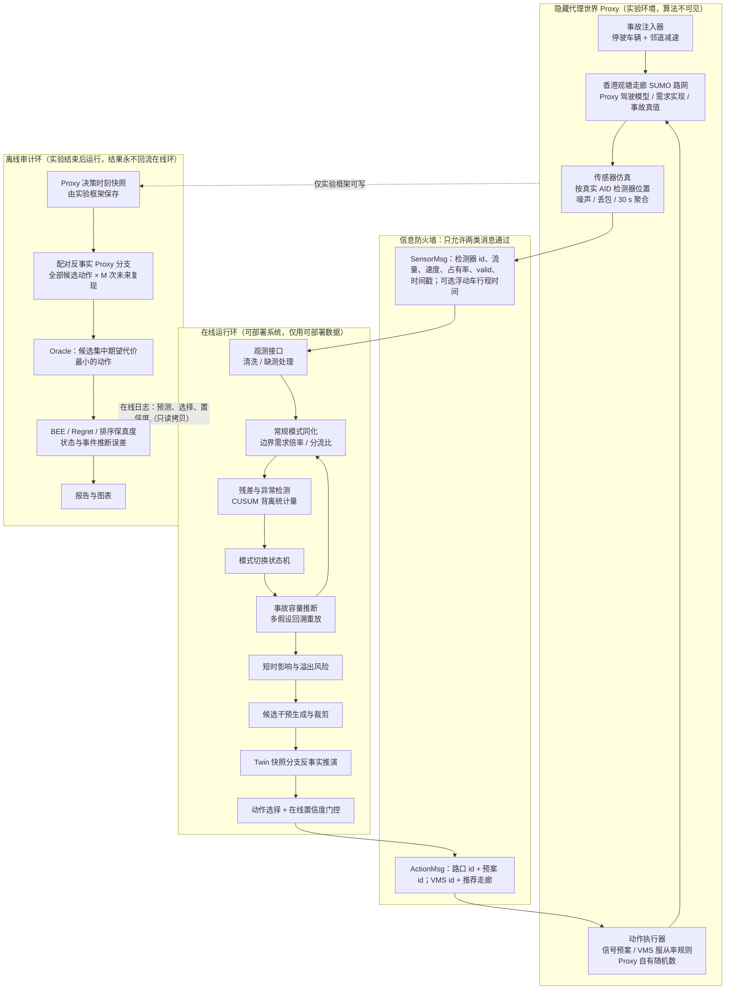

# 《城脉·涟控》技术修订版实施方案（Rev.2）

> 文档性质：内部实施方案，不是提交材料。凡标注 `[TBD]` 的数值都必须由实验产生后才能写入任何对外材料。
> 修订依据：`deep-research-report1.md`（Rev.1）+ 第二轮五模型评审 `fleet-review-of-deep-research-report1.md` + 本轮任务书。
> 日期：2026-10-02。Day 1 = 10/2，Day 21 = 10/22，提交截止 10/25 12:00。
> 本文所有外部事实都附可解析链接（见 §X 参考文献及核验状态）。文中没有未解析的引用标记（下文出现的 `citeturn` 字样只用于描述打包检查规则）。

---

## 0. 本次修订改了什么（相对 Rev.1）

| Rev.1 的问题 | Rev.2 的处理 |
|---|---|
| “Decision Regret”被包装成首创性主创新 | 降级为离线可信度审计的三项指标之一（§K），并删除所有“首次/首创”表述 |
| 架构图中 C5（regret/置信度）同时接收 Proxy 真值又回流在线 Twin，信息泄漏 | 改为在线环与离线审计环两张严格隔离的架构（§D），离线结果不回流运行时（§E） |
| Proxy/Twin 失配只是一个标量需求倍率（1.12 vs 0.95，同一基础需求） | 改为 9 维结构失配矩阵（§F），连需求生成过程、驾驶模型、事故表示方式本身都不同 |
| 同化会把事故“校准掉”，却没有具体机制 | 设计事件感知双模同化 + 多假设回溯重放（§G、§H），这是本项目的技术重心 |
| 预测器与 no-action rollout 功能重复 | AI 层改为负责异常检测、事件定位先验、溢出风险和动作空间裁剪；物理 Twin 负责反事实验证（§I） |
| 绕行动作把 Twin 中的车辆路径直接传给 Proxy | 改为基础设施级动作语义（信号预案、VMS + 服从率），两个世界各自独立执行（§J） |
| 单次随机运行定义 oracle | 采用公共随机数配对 + 多次未来复现 + 选择/评估拆分（§L） |
| 文档在排期中“D1 目录 → D18 90%”断档 | 改为四列交付物排期，每 1–2 天同时有实现、实验、文档交付物和验收标准（§S） |
| 演示脚本里的数字（91.8%、8.3→3.1、47 s、94%、18.7%、0.9）看起来像实测结果 | 全部改为 `[TBD]`，并统一纳入 `docs/numbers.md` 管控（§V） |
| 网络与数据来源不统一（OSM 城市 + 香港数据接口演示） | 主网络改为香港九龙东观塘道—观塘绕道走廊，实测数据和仿真路网在同一条物理道路上（§N） |

---

## A. 一句话项目定义

**《城脉·涟控》：一个在稀疏感知和结构性模型失配条件下，能区分“需求波动”与“突发通行能力损失”、不把事故校准掉、并在执行前用反事实仿真检验干预方案、执行后用独立隐藏世界审计决策可信度的交通数字孪生闭环原型。**

正式题目建议：

> 《城脉·涟控——面向突发事件与模型失配的事件感知交通数字孪生协同管控系统》

（去掉 Rev.1 题目里的“可信”二字作为标题核心词也可以；“可信”放在副标题或创新点 3 中，避免题目承诺超过证据。）

## B. 问题陈述

城市交通数字孪生的常规做法是持续用观测残差校正模型参数，通常是需求。这一做法隐含一个假设：**孪生与现实的差异来自缓慢变化的需求偏差。**

突发事故违背这一假设。事故使某路段通行能力骤降，上游排队，下游放行流量下降。只看下游检测器，“流量变低”与“需求变低”无法区分。如果孪生继续按常规模式校正需求，它会：

1. 把下游流量下降解释为需求减少，压低估计需求；
2. 局部残差暂时变小，看起来“同步良好”；
3. 但孪生中的道路通行能力仍是正常值，排队和溢出无法复现；
4. 基于这个孪生做的拥堵预测和管控决策是错的。

**本项目回答的问题：**

> 当现实交通系统与其数字孪生存在结构性差异、观测稀疏且有噪声，而一起未通报的事故突然削减了道路通行能力时，孪生能否：
> (1) 发现“需求校正假设”已经失效；
> (2) 推断最可能的通行能力损失位置与严重度；
> (3) 恢复同步并预测拥堵传播；
> (4) 用反事实仿真评估候选干预；
> (5) 让其预测的干预效果在隐藏的代理世界中执行时仍然成立？

**原型的边界（必须在所有材料中如实说明）：**
- 隐藏代理世界（Proxy）是刻意与孪生不同的 SUMO 仿真，不是真实香港交通系统。
- 真实香港数据用于路网几何、检测器布设位置、基线需求标定和基线交通特性验证。
- 事故注入与管控实验只能在 Proxy 中做，因为真实世界的一条观测轨迹无法给出“不干预会怎样”的因果对照。

## C. 三项核心创新

只保留三项。普通工程组件（Web 大屏、消息总线、SUMO 调用）不列为创新。

### 创新 1：事件感知的双模数字孪生同化

- **内容**：正常模式只在边界检测器“非拥堵”时更新入口需求。一旦出现上下游背离型残差（上游拥堵、下游欠载），立即冻结受影响区域的需求更新，转入事故假设推断。推断方式是多假设回溯重放：从环形快照中回退，对每个“路段 × 严重度”假设重放，用似然比较选出最优解释，再把孪生重放到当前时刻，使已形成的排队在孪生中被复现，而不是从检测时刻才开始生成。假设库中始终保留“纯需求变化”和“检测器故障”两个竞争解释。
- **为什么不是标准 SUMO 功能**：SUMO 只提供仿真和状态保存/加载。区分需求与容量的触发统计量、冻结规则、假设库、回溯重放和恢复判据都是本项目设计的。
- **相关工作（如实承认）**：基于模型的事故检测（Willsky 等，1980）和基于宏观模型的状态/参数估计（Wang & Papageorgiou，2005 的 EKF 方法）早已存在。本项目的贡献在于：在微观仿真孪生的在线闭环中，显式处理需求与容量的混淆，并用独立隐藏世界检验其对决策的影响。这是集成与验证层面的贡献，不是新的估计理论。
- **可证伪实验**：§M 的决定性实验 E\*。如果事件感知同化在下游排队预测误差上不显著优于常规同化（配对差的 95% CI 不排除 0），创新 1 不成立，必须照实报告。

### 创新 2：结构性失配下的反事实管控

- **内容**：候选干预在“已同化但刻意与现实不同”的孪生中，按事故假设的后验集合做配对反事实推演。动作采用两个世界语义一致的基础设施级动作（信号预案、VMS 诱导 + 服从率）。选中动作在隐藏 Proxy 中独立执行，Twin 不知道 Proxy 的驾驶模型、真实需求和真实服从率。
- **与工业产品的关系**：PTV Optima、Aimsun Live 已提供实时仿真预测与方案评估（见 §Q）。本项目不声称首创“what-if”，而是研究在结构失配与事故未知时，这些评估还可信到什么程度。
- **可证伪**：§K 的 BEE 与排序一致性。如果 Twin 的动作排序与 Proxy 配对评估的排序相关性接近 0，说明这种反事实管控在失配下不可信，照实报告。

### 创新 3：决策保真度审计协议

- **内容**：评价孪生时不只看状态重建误差，还要看三个指标：Twin 预测的干预收益是否在 Proxy 中兑现（BEE）、Twin 选的动作比候选集中真实最优差多少（Decision Regret）、Twin 的方案排序与 Proxy 是否一致（Ranking Fidelity）。全部在离线审计环中、用配对公共随机数计算。
- **如实承认**：相对 oracle 的 regret 是 predict-then-optimize 和决策导向学习中的成熟评价方法（Elmachtoub & Grigas 的 SPO）。本项目只是把它与 BEE、排序保真度一起，作为交通孪生在结构失配条件下的审计协议来使用。
- **措辞建议**：“将决策质量审计引入交通数字孪生的验证流程”，**禁止**写“首次提出决策遗憾”。

---

## D. 在线运行环与离线审计环架构



**防火墙规则（写进说明书方法章节）：**
1. 在线环与 Proxy 只通过 `SensorMsg`（入）和 `ActionMsg`（出）两类消息通信。在线进程没有 Proxy 的 TraCI 端口、文件路径或内存访问。
2. 离线审计环在一次实验运行结束后才启动，读取 Proxy 快照和在线日志的只读拷贝，输出只写入 `results/audit/`。Proxy 在实验模式下每 30 s 把自身状态快照写入审计卷，审计框架选取决策时刻 t_d 对应的快照。**隔离靠操作系统层面实现，不只靠代码检查**：用 Docker Compose 运行三个容器（proxy / online / audit）。审计卷和 Proxy 快照卷不挂载到 online 容器；online 容器的网络只能访问消息总线。另外，CI 静态检查（§R）作为第二道防线。
3. 审计结论只能用于**实验轮次之间**的人工设计修改，而且只能在开发集种子上进行。最终测试集种子在设计冻结前不可运行（§L.5）。
4. 在线置信度只由在线可得信息计算（§G.6），与离线 regret 无关。Rev.1 中“C5 → T2”的箭头删除。

## E. 信息防火墙表

| 信息 | 在线环可否使用 | 依据 / 说明 |
|---|:---:|---|
| 布设检测器的 30 s 流量、平均速度、占有率、valid 标志 | **可以** | 香港运输署原始数据即为此格式（每车道，30 s 区间） |
| 传感器时间戳、在线/离线状态 | **可以** | 真实系统可得 |
| 低渗透率浮动车行程时间（可选，默认关闭） | 可以（鲁棒性实验） | 真实系统可通过合作数据获得；必须加噪声与渗透率 |
| 本系统管辖的信号灯当前相位与配时方案 | **可以** | 交通控制中心掌握自身信号状态 |
| 本系统发出的动作及其执行时刻 | **可以** | 自身操作记录 |
| 异常检测器自身推断出的事件信息 | **可以** | 由可部署数据推导而来 |
| Proxy 全量车辆位置/速度/路径 | **禁止** | 现实不可得 |
| Proxy 真实 OD / 需求实现 / 未来出发计划 | **禁止** | 防止未来信息泄漏；Twin 用自己的需求生成器 |
| 真实事故标志、位置、发生时刻、持续时间 | **禁止** | 必须由残差推断 |
| 真实通行能力损失比例 | **禁止** | 仅离线审计使用 |
| Proxy 驾驶模型参数、真实 VMS 服从率 | **禁止** | 结构失配的一部分 |
| Oracle 最优动作、no-action 反事实结果 | **禁止** | 仅离线审计 |
| 非布设路段的任何真值 | **禁止** | 稀疏感知设定 |
| 用于训练任何学习模块的数据 | 只能来自 **Twin 侧模型族或独立训练世界** | 不得用 Proxy 测试配置生成训练数据，否则结构失配被“学会”，构成间接泄漏 |
| Proxy 初始状态（热启动） | **禁止** | Twin 从自己的需求冷启动并预热，不复制 Proxy 状态 |

工程落实：`proxy_service`、`twin_service`、`audit_harness` 三个独立容器（§D 规则 2）。消息走本机 ZeroMQ（或 Redis pub/sub），消息 schema 在 Day 1 冻结。单元测试检查 `twin/`、`decision/`、`detection/` 等包不 import `proxy/`、`audit/`，且其进程环境中不含 Proxy 端口和路径。

---

## F. 结构性 Proxy–Twin 失配设计

**原则：任何一维失配都不能只靠随机种子不同来实现；两个世界的高一致性不能由构造保证。**

### F.1 失配矩阵

| 维度 | Proxy（隐藏现实） | Twin（孪生） | 主实验 | 鲁棒性实验 |
|---|---|---|:---:|---|
| D1 需求生成过程 | 由香港实测时段剖面经 `routeSampler.py` 标定的 OD/路径集，叠加每个入口独立的时变扰动（OU 过程，相对幅度 σ_D）和局部需求冲击 | 由**另一批日期**的香港数据独立标定的平滑基础需求；无扰动；Python 侧泊松插入 | ✔（σ_D 中档） | σ_D 低/高三档 |
| D2 路径选择 | 按 Proxy 自有的 logit 路径选择参数分配；部分车辆（比例 p_r）装 SUMO 动态重路由装置 | 固定分流比，在线可调（§G.3） | ✔ | p_r = 0 / 中 / 高 |
| D3 出发时刻 | 泊松出发 + 出发时刻随机偏移 | 泊松，独立随机流 | ✔ | — |
| D4 跟驰模型 | **IDM**，参数按车辆分布抽样（τ、minGap、accel、decel） | **Krauss**（SUMO 默认），统一参数 | ✔ | 同模型不同参数（低失配）/ 再加 sigma 差异（高失配） |
| D5 换道行为 | `lcAssertive`、`lcSpeedGain`、`lcCooperative` 取与 Twin 不同的值 | SUMO 默认 | ✔ | 两档 |
| D6 车型构成 | 按香港年度交通普查的车型比例（含巴士、货车）[比例 TBD，从普查数据取] | 简化为 2 类 | ✔ | — |
| D7 观测 | 真实 AID 检测器位置的子集；流量乘性噪声、速度/占有率加性噪声；丢包率 ℓ；30 s 聚合 | 只收到 D7 的输出 | ✔（实际布设 + 中噪声 + ℓ 中档） | 覆盖率降至 50%、25%；噪声 ×2；ℓ 高档 |
| D8 对 VMS 的行为响应 | 真实服从率 c_P 按场景从区间抽样，对 Twin 隐藏 | 假设服从率 c_T（固定配置值） | ✔ | c_P 与 c_T 偏差三档 |
| D9 事故表示方式 | 物理停驶车辆占用车道（`vehicle.setStop`）+ 邻道“围观减速”区段 | 假设空间为“封闭 k 条车道 + 剩余车道限速系数 s”（`lane.setDisallowed` + `lane.setMaxSpeed`） | ✔ | — |

D9 是刻意设计：Twin 永远不可能用与现实完全相同的机制复现事故，只能用一个近似的容量损失参数化去解释它。

### F.2 “真实通行能力损失”的定义

SUMO 中的通行能力是涌现量，不是输入参数。定义方式如下：
- **Proxy 真值**（仅审计用）：在审计框架中对同一事故配置做饱和上游流量测试，测得事故断面排队消散流率，与无事故时比值记为 ρ_true。
- **Twin 估计**：离线在 Twin 模型中为每种 (k, s) 组合测得 ρ(k, s)，形成查找表。在线推断出 (k̂, ŝ) 后得到 ρ̂ = ρ(k̂, ŝ)。
- **误差**：|ρ̂ − ρ_true|。由于两个世界的驾驶模型不同，同一物理堵塞在两个世界中的 ρ 本就不同，这正是结构失配的体现，必须如实解释。

### F.3 失配强度的验证

在无事故条件下，报告未同化与常规同化两种情况下 Twin 对 Proxy 的状态误差。如果未同化时误差已经极小，说明失配不够，需要加强失配，不能把这当作好结果。

---

## G. 事件感知双模同化算法

### G.1 输入与时间节拍

- 观测：每个检测器 i、每 30 s 区间 t 的 (q_i, v_i, o_i, valid_i)。缺测（valid = N 或丢包）记为缺失，不插补进残差。
- Twin 内在相同位置布设 E1 感应线圈（`inductionLoop`，period = 30 s），通过 `traci.inductionloop.getLastIntervalVehicleNumber / getLastIntervalMeanSpeed / getLastIntervalOccupancy` 读出上一个完整 30 s 区间的 Twin 观测 (q̂_i, v̂_i, ô_i)。这些是 SUMO 文档中的“previous interval”接口（0x27–0x29）；`getInterval*` 是当前未完成区间，不要用。两个审计员都声称这组函数名不存在，已对照 SUMO 文档核实存在。占有率两侧单位都是百分比；香港数据的占有率为整数百分比。
- 同化节拍：每 60 s 一次，使用最近 2 个 30 s 区间。事故假设评估每 60 s 一次。
- 快照：Twin 每 30 s 调用 `traci.simulation.saveState` 写一次快照，环形保留最近 **15 分钟**（30 个），以覆盖“检测延迟 + 回溯余量 Δ + 5 分钟”。回溯余量 Δ = 60 s。快照大小与保存耗时在 D4 实测 `[TBD]`。若所需快照已被淘汰，就用最早可用的快照，并在日志中记录。
- **Twin 需求的公共随机数（泊松稀疏化）**：每个入口 s 预先生成一条“候选到达流”，按上限速率 λ_max,s 产生到达时刻 t_n，并为每个到达预抽均匀数 u_n、路径抽样数 g_n，以 (运行种子, s) 为种子。仿真中，候选到达 n 被接受当且仅当 u_n < λ_s(t_n)/λ_max,s；路径由 g_n 和当前分流比决定。这样，任意 m_s 取值下的插入都是同一随机源的确定性函数。所有分支（事故假设、决策方案）和回溯重放读取同一条候选流，自然实现跨分支 CRN，回退后也不会重复或遗漏车辆，因为读取指针随快照时间回退。

### G.2 残差与标准化

对每个检测器 i、每个量 x ∈ {q, v, o}：

```
r_i^x(t) = ( x_i(t) − x̂_i(t) ) / σ_i^x
```

σ_i^x 取常规运行期间（预热后、无事故）残差的稳健尺度 1.4826·MAD。它同时包含测量噪声和结构失配，这是有意的：似然因此不会把失配当作事故。

对沿车流方向相邻的检测器对 (U, D)，即 U 在上游、D 在下游、中间无主要出入口，定义**背离统计量**：

```
B_UD(t) = w_o · ( r_U^o(t) − r_D^o(t) ) + w_v · ( r_D^v(t) − r_U^v(t) )
```

其物理含义是上游占有率偏高、速度偏低，同时下游占有率偏低、速度不低。这是两者之间存在瓶颈的特征。权重初值 w_o = w_v = 0.5 `[开发集调参]`。

**B 的局限（不夸大）**：
- 需求阶跃在 Twin 跟上之前（常规更新的滞后期内）也会产生短暂的 B。这由 CUSUM 的累积要求和假设库中的需求假设 H0 来区分，不由 B 单独区分。
- 上游检测器故障若表现为“高占有率 + 低速度”，会**模仿瓶颈**，B 无法区分。只能靠 H_det 假设，而且 H_det 必须建模故障特征（见 §G.4），不能简单剔除通道。
- 检测器对 (U, D) 的定义必须对照观塘绕道的匝道位置逐一核查，确保“中间无主要出入口”。D2–D3 产出检测器对清单并人工审核。
- 一端缺测或 valid = N 时，该区间不计算 B，CUSUM 保持不变（不增不减）。连续缺测超过 3 分钟时，该检测器对退出监测，并在界面告警。

辅助统计量：
- **全局需求偏移**：边界检测器流量残差的中位数 r̄^q_boundary（同号偏移说明是需求变化）。
- **单点异常**：|r_i| 很大，但 i 的上下游邻居都正常且 valid 正常，判为疑似检测器故障候选。

### G.3 常规模式（NORMAL）参数更新

**参数向量**：
- m_s：每个边界入口 s 的需求倍率。Twin 侧插入率为 λ_s(t) = m_s · base_s(t)。
- w_j：主要分流点 j 的分流比（可选，每个分流点 1–2 个自由度）。

**入口需求更新**（每 60 s）：

```
若 边界检测器 b(s) 的观测占有率 o_b < o_crit（非拥堵）且 valid：
    e_s = ( q_b − q̂_b ) / base_s(t)
    若 |r_b^q| > δ（死区，初值 1.0σ）：
        Δ = clip( κ · e_s , −0.05 , +0.05 )      # 每次最多变化 5%
        m_s = clip( m_s · (1 + Δ) , m_min , m_max )   # 初值 [0.5, 1.8]
否则：
    m_s 保持不变        # 拥堵时的流量不等于需求，不更新
```

- κ 初值 0.3 `[开发集调参]`；o_crit 取该路段类型的临界占有率，初值 15% `[由香港数据的流量—占有率散点估计]`。
- 为什么不用 RLS：恒定需求下 RLS 会失去激励，协方差收缩导致停止跟踪；需求剧变时又会过冲。带死区、限速、限幅的比例更新更透明，也容易解释振荡来源。在开发集上画出 m_s 时间轨迹作为诊断图。
- **分流比更新**（可选）：分流点 j 下游两侧检测器流量比与 Twin 的比较，用 5 分钟窗口和同样的限速/限幅规则。只在两侧都非拥堵时更新。

**为什么 Twin 不用 SUMO calibrator**：SUMO 文档说明，calibrator 会在车道“拥堵超出预期”时移除车辆，以阻止“无效”拥堵向上游增长（`jamThreshold`）。这恰好会删除我们要复现的事故排队。因此 Twin 的需求完全由 Python 侧的泊松插入（`traci.vehicle.add`）产生，路径从 Twin 自己的路径分布抽样。这样还有两个好处：分支推演时未来需求来自 Twin 自己的需求预测，不会读到 Proxy 的未来；也避免了 SUMO 快速加载状态时 flow 定义的车辆可能缺失的问题。

### G.4 事件模式：多假设回溯重放

**假设库 𝓗**（分三个族，族级先验各 1/3，族内均匀分配，避免某一族因假设数量多而在先验上占优）：
- **需求族 H0(f, t_on)**：受影响入口在 t_on 发生需求阶跃，倍率 f ∈ {0.7, 0.85, 1.15, 1.3}，不加容量损失。这是离散网格，与事故族的网格规模相当。不使用“在当前 m_s 下重放”的做法，因为那会使似然比偏向事故假设。
- **检测器故障族 H_det(i, 类型)**：检测器 i 出现某种故障特征，类型 ∈ {卡死于常数, 归零, 噪声放大}。该检测器的观测按故障模型计算似然（例如噪声放大型把该检测器的 σ 放大 5 倍），**不剔除通道**，以保证所有假设在同一观测集合上比较。
- **事故族 H(e, k, s, t_on)**：路段 e 上封闭 k 条车道、剩余车道限速系数 s、起始时刻 t_on。
  - 候选路段 e：触发对 (U, D) 之间的所有路段，以及向上游、下游各扩展 1 段。
  - (k, s) 网格：k ∈ {1, …, 车道数 − 1}（全封闭单列）；s ∈ {1.0, 0.6, 0.3}。对应的 ρ 来自 §F.2 查找表。
  - t_on：由 CUSUM 变点估计给出，±1 个区间。
  - 规模：典型 4 条路段 × 4–6 个 (k, s) × 1–3 个 t_on，约 16–72 个假设。由 §I 的定位先验裁剪到前 N_h 个（初值 12）。

**评分**：对每个假设 h，从环形快照中取 S(t_on − Δ)，在独立 SUMO 进程中加载该快照。加载后**重新施加控制状态记录**（§J.5：当前生效的信号方案、车道限制、VMS 策略），再施加该假设的参数，用同一条候选到达流（§G.1，跨假设 CRN）重放到当前时刻 t，读出窗口内所有检测器的 Twin 观测。

为了降低时间自相关，残差先按检测器聚合为 2 分钟块均值 r̃_i^x(b)，再计算：

```
观测集合 O：窗口内所有“该检测器该块 valid”的 (i, b, x)，所有假设共用同一个 O
logL_h = Σ_{(i,b,x)∈O} [ −½ (r̃_i^x(b; h) / c_i^x(h))² − ln c_i^x(h) ]
         # c = 1；故障假设下被指定检测器取 c = 5（含归一化项，放大 σ 不是“免费”的）
后验 P(h) ∝ π(h) · exp( β · logL_h )
```

- β 是温度系数，在开发集上标定：调整 β，使后验与实际正确率在可靠性图上大致对齐。这是因为相邻检测器和相邻时间块的残差仍然相关，不做温度标定时，后验会过度自信。β 的初值取 1/ 块自相关膨胀因子 `[开发集估计]`。
- 族级先验 π 如上；若启用 §I 的定位先验，则只在事故族内部重新分配概率。
- 若 SUMO 内部随机数在分支间无法保持一致（例如车辆跟驰的随机项），则每个假设跑 R_h = 2 次复现取 logL 平均。D9 测量同一假设两次复现的 logL 差异，并以此确定 R_h `[TBD]`。

**选择与重放**：取 MAP 假设 h\*。如果 h\* 属于事故族，且其对数后验比需求族中最大者高出 τ_LR（初值 ln 10），则把 h\* 的参数施加到 Twin，并让 Twin 进程从 S(t_on − Δ) 用 h\* 重放到 t，替换当前 Twin 状态。这样，现实中已经形成的排队也在 Twin 中出现，而不是从检测时刻才开始。

**残差解释度**：

```
EVR = 1 − SSE_{h*} / min_{需求族} SSE      # 相对最佳纯需求解释，事故假设多解释掉的残差比例
                                         # SSE 在同一观测集合 O 上计算
```

**跟踪更新**：在 EVENT_ASSIMILATION 状态下每 60 s 只评估局部邻域（h\* 及严重度 ±1 档、相邻路段、“已解除于 τ_c”假设），做爬山式更新，控制计算量。

**区域冻结**：处于 SUSPECTED_EVENT 或 EVENT_ASSIMILATION 时，所有路径经过候选路段集合的入口 s，其 m_s 冻结。其他入口继续常规更新。

### G.5 恢复检测

Proxy 中事故解除（停驶车辆驶离）时，Twin 并不知道。解除后会出现与事故发生时相反的残差模式：Twin 预测的上游排队比观测更严重，下游观测流量高于 Twin。

处理方式：在跟踪更新中加入假设 H_clear(τ_c)，τ_c 取最近 5 分钟内的若干时刻，用同样的回溯重放评分。**连续两次评估**（间隔 60 s）都满足 P(H_clear) > 0.7 时，移除 Twin 中的车道限制（同样从 τ_c 前的快照重放），进入 RECOVERY 状态。进入时把受影响检测器对的 S_UD 清零。

**RECOVERY 期间的触发屏蔽**：由于驾驶模型失配（D4），Proxy 与 Twin 的排队消散速度本就不同，消散期间的背离不能当作新事故。因此在 RECOVERY 中，受影响检测器对的背离触发被屏蔽，直到两端占有率都回到 o_crit 以下。之后 CUSUM 重新启用，才可能判为二次事故。RECOVERY 最短停留 3 分钟。

### G.6 在线置信度（只用在线信息）

不输出一个拼凑的“置信度 %”，而是展示四个有明确定义的分量：

| 分量 | 定义 | 用途 |
|---|---|---|
| 事件后验 P(h\*) | §G.4 | 是否接受事故解释 |
| 残差解释度 EVR | §G.4 | 事故假设是否真的解释了观测 |
| 动作排序稳定度 P_best(a) | 在后验前 K 个假设 × R 次 Twin 复现下，a 为最优的频率 | 决策门控 |
| 解除后验 P(H_clear) | §G.5 | 是否进入 RECOVERY |
| 近期预测技能 FS | 最近 10 分钟内 Twin 的 5 分钟预测相对持续性预测的误差比 | 现实部署中可观测的可信度信号 |

**执行门控**（在线反馈机制，替代 Rev.1 的 C5→T2）：
- 自动推荐动作 a 的条件：P_best(a) ≥ 0.7，且**符号一致性**达标：在 R₁ + R₂ = 6 次 CRN 配对复现（跨后验前 K 个假设）中，至少 5 次 J_T(a) < J_T(A0)。不用 3 次复现上的 t 区间，因为自由度只有 2，不可靠。
- 不满足时，界面显示“建议谨慎 / 维持现状”，由操作员决定。实验模式下按预先声明的规则自动执行 A0 或 a，规则写入实验协议。
- 当 P(h\*) < 0.5 时，假设库保持宽搜索（N_h 不裁剪），需求冻结也不解除。

这些反馈只使用在线信息，不涉及 Proxy 真值。

## H. 状态机与伪代码

```
状态：NORMAL → SUSPECTED_EVENT → EVENT_ASSIMILATION → RECOVERY → NORMAL
      SUSPECTED_EVENT → NORMAL（误报撤回 / 判为检测器故障）
      SUSPECTED_EVENT → DEGRADED → EVENT_ASSIMILATION 或 NORMAL（有界的未定状态，无死锁）

参数初值（全部在开发集种子上调参，测试集冻结前不可调）：
  CUSUM: k = 0.5, h = h_ARL      # 针对“CUSUM 或速度/占有率双条件”这一并集触发整体标定，
                                 # 在三个需求水平的无事故运行上分别标定（高峰时失配更大），
                                 # 目标误报率 ≤ 1 次 / ARL_target 小时 [TBD]
  τ_LR = ln(10)（作用于温度标定后的后验）；P_clear = 0.7（需连续 2 次）
  T_susp_max = 3 次评估（3 分钟）；T_degraded_max = 15 分钟
  恢复判据：受影响检测器对两端占有率 < o_crit，未屏蔽的 CUSUM 统计量 < h/2 持续 3 分钟，
           且 RECOVERY 已停留 ≥ 3 分钟
  在 EVENT_ASSIMILATION 中，同一路口两次动作之间至少间隔 5 分钟（§J.2）

每 30 s（新观测到达）：
  读入 SensorMsg；Twin 推进 30 s（Twin 与 Proxy 仿真时钟同步，见 §J.4）
  计算 r_i^x、B_UD、r̄^q_boundary
  对每个 (U,D)：S_UD = max(0, S_UD + B_UD − k)
  每 30 s 保存 Twin 快照到环形缓冲

每 60 s：
  switch state:
    case NORMAL:
      常规更新 m_s, w_j（§G.3）
      if any S_UD > h  or  (r_U^v < −3 且 r_U^o > 3 连续 2 个区间)：
          标记候选区域 R = 触发对及其上下游一段
          冻结 R 相关入口的 m_s
          t_on_hat = CUSUM 变点估计
          启动假设评估（H0、H_det、H(e,k,s,t_on)）
          state = SUSPECTED_EVENT；n_eval = 0
    case SUSPECTED_EVENT:
      n_eval += 1；评估假设库，计算后验
      if h* ∈ 事故族 and log P(h*) − log max_{需求族} P > τ_LR：
          施加 h* 并从 S(t_on − Δ) 回溯重放到当前
          state = EVENT_ASSIMILATION
          触发决策流程（§J）
      elif 需求族总后验 > 0.6 连续 2 次：
          把 MAP 需求假设的倍率 f 写入受影响入口的 m_s
          解冻 m_s；记录误报；state = NORMAL
      elif h* = H_det(i)：
          标记检测器 i 降权；解冻；state = NORMAL
      elif n_eval ≥ T_susp_max：
          state = DEGRADED（未定子状态）：界面告警“残差未被解释”
          冻结入口改为慢速更新（κ/4，死区 2σ），避免 Twin 永久停止同化
          每 2 分钟重新评估一次假设库；满足 τ_LR → EVENT_ASSIMILATION
          停留超过 T_degraded_max → NORMAL，并记录“未解释异常”事件（计入 Q3 统计）
    case EVENT_ASSIMILATION:
      局部邻域更新 h*（严重度 ±1、相邻路段、H_clear(τ_c)）
      非 R 区域继续常规同化
      每 5 分钟或 h* 显著变化时重新评估决策（带最短保持时间，防止动作抖动）
      if 连续 2 次 P(H_clear) > P_clear：
          移除车道限制并从 S(τ_c − Δ) 重放
          清零受影响对的 S_UD；屏蔽其背离触发（直到两端占有率 < o_crit）
          state = RECOVERY；κ_R = 0；t_rec = now
    case RECOVERY:
      κ_R 在 5 分钟内从 0 线性升到 κ；仅对非拥堵边界检测器更新 m_s
      屏蔽解除后，若出现新的背离触发 → SUSPECTED_EVENT（二次事故，或判定解除有误）
      if 恢复判据满足 且 now − t_rec ≥ 3 min：state = NORMAL；清零全部 S_UD
```

**计算量**：每次假设评估要并行运行 N_h 个 Twin 分支，每个分支模拟 (t − t_on + Δ) 秒，约 2–5 分钟仿真时长。实际墙钟耗时在 D9–D10 实测 `[TBD]`。若超过 30 s，则降低 N_h，或把 t_on 网格缩到 1 档。

---

## I. AI 模块的职责

AI / 数据驱动层与物理孪生层的分工必须清楚，并且每个 AI 组件都要有可测的独立价值。

| 组件 | 方法（MVP） | 可选增强 | 物理 rollout 为什么不能替代 | 如何证明价值 |
|---|---|---|---|---|
| 异常检测 | 背离型 CUSUM（§G.2），不需要训练 | — | rollout 本身不判断“现在是否异常” | 检测延迟、误报率（Q3） |
| 事件定位与类型先验 | 物理启发：取“最后一个拥堵检测器与第一个非拥堵检测器之间”的路段 | **计划内**：LightGBM 分类器，输入残差特征，输出 {容量损失, 需求冲击, 检测器故障} 的概率与路段排序。**训练数据只来自 Twin 模型族生成的合成事件** | 不裁剪时假设库太大，每次评估墙钟时间过长 | 消融：有/无先验时的定位准确率与评估耗时（或所需分支数） |
| 溢出风险预测 | 解析的“排队存储”模型：每段剩余存储容量 ÷ 当前排队增长率 = 预计溢出时间；排队增长率 = 推断的入流 − ρ̂ × 正常通行能力 | 小型 GCN-GRU，只有在开发集上的溢出时间 MAE 优于解析模型时才保留 | rollout 只给出 MAP 假设下的单条轨迹，而且每次需要秒级时间；风险图需要每 30 s 刷新全网 | 溢出时间 MAE、受影响路段 F1（Q2），与 rollout 结果对照 |
| 候选动作裁剪 | 由溢出风险确定“哪些路口需要预案、哪个 VMS 有意义”，生成 3–5 个候选 | — | 动作组合空间随路口数呈指数增长，rollout 只能评估少量动作 | 候选数与覆盖率：裁剪后的最优动作是否仍在候选集中（离线审计时用全组合在 Twin 中检查） |

**物理孪生层负责**：显式反事实推演、候选方案检验、最终 KPI 估计、约束检查（最小绿灯、行人清空时间、周期范围）。

**不做的事**：不用深度学习替代交通物理，不用 LLM 做控制。若 GCN-GRU 在开发集上不优于解析模型，则不进入系统，并在说明书里写明这一比较结果。这本身就是一个诚实的结论。

**定位口径**：MVP 的核心推断是统计推断（CUSUM + 温度标定的贝叶斯多假设推断）。LightGBM 定位先验是计划内的学习组件（D13–D14 实现，D16 消融）。如果它未完成或消融显示无益，材料中就不使用“AI 驱动”这类表述，改称“数据驱动的统计推断 + 物理仿真”。

---

## J. 候选干预与动作空间设计

### J.1 动作语义（两个世界一致，不传递车辆 ID）

| 动作 | 语义 | 在两个世界中的实现 |
|---|---|---|
| A0 | 维持现状（当前固定配时预案） | — |
| A1 | 事故信号预案：对受影响路口切换到预先批准的事故预案 P_k。上游路口限流，压缩驶向瓶颈方向的绿灯；溢出路口给横向道路延长绿灯，防止路口堵死 | `traci.trafficlight.setProgram(tls, P_k)`，在周期边界切换；预案逻辑在 Day 2–3 写入两个世界的 `tls` 附加文件 |
| A2 | VMS 分流诱导：上游 VMS 显示“建议改行走廊 B”。经过 VMS 断面、且原路径经过事故走廊并在汇合点之后继续的车辆，以概率 c 服从 | 各世界独立执行。**走廊 B 是预先定义的固定边序列**（VMS 下游分岔点 → 汇合点），不用 `findRoute` 动态求路，否则两个世界会算出不同路径，破坏语义一致性。逐步用 `traci.edge.getLastStepVehicleIDs` 记录首次出现在 VMS 边上的车辆。服从判定用按车辆 ID 哈希得到的均匀数 u_v（服从当且仅当 u_v < c），这样跨方法、跨分支都是 CRN。服从车辆的新路径 = 原路径到分岔点的前缀 + 走廊 B + 原路径汇合点之后的后缀，用 `traci.vehicle.setRoute` 设置。Twin 用 c_T，Proxy 用隐藏的 c_P |
| A3 | A1 + A2 | 组合 |
| A4（可选） | 匝道/路口限流加强版 | 同 A1，另一预案 |

### J.2 约束（硬约束，不进入加权代价）

- 预案只能从预先审批的预案库中选择，每个预案都满足最小绿灯和行人清空时间，周期在规定范围内 `[具体值按香港惯例设定，需注明为工程假设]`。
- 同一路口两次切换之间的最短保持时间为 5 分钟，防止抖动。
- 产品模式下由操作员审批（人在回路）；实验模式下按 §G.6 的门控规则自动执行，并在说明书中明确披露。

### J.3 决策代价

在评估窗口 [t_a, t_a + H] 内（H 初值 20 分钟，需覆盖事故后排队消散；开发集上检查 H 是否足够，若大量车辆在窗口末仍未完成行程，则加长 H）：

```
J(a) = 网络总车辆延误（veh·h），包括：
       - 已完成行程车辆的延误（tripinfo timeLoss）
       - 窗口末仍在网内车辆至窗口末的延误（--tripinfo-output.write-unfinished）
       - 因路网拥堵无法插入车辆的等待延误（departDelay）
```

后两项不能省略。否则把车辆堵在路网外的方案会显得延误更低，这是典型的删失伪影。用 `traci.vehicle.add` 插入的车辆在入口受阻时是否计入 tripinfo 的 departDelay，D4 验证。若不计入，由 Python 侧自行累计等待插入的车辆时间。

**瞬移（teleport）**：SUMO 默认会把等待过久的车辆瞬移走，这会让排队凭空消失，构成删失。有计划停车的车辆（Proxy 的事故车）不计入等待时间，不会被瞬移，但排在其后的车辆会。因此 Proxy 与 Twin 都把 `--time-to-teleport` 设为负值（禁用），或设为远大于事故时长的值。每次运行记录瞬移次数作为有效性指标；瞬移次数非零的运行单独列出，不并入均值。

**CO₂**：需启用排放设备（`--device.emissions.probability 1`）才会写入 tripinfo/emission 输出。数值为 SUMO 内置 HBEFA 模型估算。排队长度、溢出路口数、CO₂（SUMO HBEFA 模型估算值，不是实测）作为辅助 KPI 单独报告，不进入主代价。如需加权代价，权重放在附录里做敏感性分析。

### J.4 决策时延的处理

- 实验中，Proxy 与 Twin 按仿真时钟同步推进。决策计算发生在 t_d，动作在 Proxy 中于 t_d + L_dec 生效。
- L_dec 取 D11 实测的决策墙钟耗时 P95，向上取整到 30 s `[TBD]`。这样，“计算需要时间”这一事实被计入实验，而不是假设瞬时决策。
- 现场演示时，如果用暂停时钟等待计算，必须口头说明。

### J.5 控制状态记录（快照加载后必须重新施加）

SUMO 状态文件不保证保存运行时修改，例如 `setProgram` 切换的信号方案、`setDisallowed` / `setMaxSpeed` 设置的车道限制、Python 侧的 VMS 策略状态。因此 Twin、所有分支和审计框架都维护一份**控制状态记录**：每个路口当前生效的方案 id 及切换时刻、每条车道的限制、VMS 当前信息与生效时刻、候选到达流的读取位置。每次 `loadState` 之后，按记录逐项重新施加，不依赖状态文件。

Proxy 的事故（停驶车辆的停车计划）是否随状态保存，D4 一致性测试中专门验证。D4 测试还必须包含一个用例：快照**之前**已施加过某个动作（例如 A1 切换了方案），确认加载后 A0 分支保持的是“当前方案”，而不是初始方案。否则审计中的 A0 就不是真正的维持现状。

---

## K. 决策保真度审计方法（仅离线）

对一次实验中 Twin 在 t_d 做出的决策，审计框架读取 Proxy 在 t_d 的快照（由实验框架在该时刻保存，在线环不可访问），对候选集 𝒜 中的每个动作 a 运行 M 次配对的未来复现，得到 Proxy 代价 J_P(a; m)。

### K.1 三个指标（不得混用名称）

**收益估计误差 BEE（Benefit Estimation Error）**——不是 regret：

```
Ĝ_T(a*) = J̄_T(A0) − J̄_T(a*)          # Twin 预测收益（用独立于选择的 Twin 复现估计，见 §L.4）
G_P(a*) = J̄_P(A0) − J̄_P(a*)          # Proxy 配对实现收益
BEE     = | Ĝ_T(a*) − G_P(a*) |       # 同时报告带符号的 Ĝ_T − G_P，以显示乐观偏差的方向
```

相对版本（除以 J̄_P(A0)）也报告，但必须注明分母。

**决策遗憾 Decision Regret**：

```
Regret     = J̄_P(a*) − min_{a∈𝒜} J̄_P(a)                 # 单位：veh·h
Regret_rel = Regret / ( J̄_P(A0) − min_{a∈𝒜} J̄_P(a) )     # 占“可获得收益”的比例；分母接近 0 时不报告
```

只对候选集 𝒜 内部定义，不声称是全局最优。

**排序保真度 Ranking Fidelity**：
- Top-1 一致率：Twin 最优动作 = Proxy 期望代价最优动作的比例。
- Spearman ρ：Twin 与 Proxy 对 𝒜 的排序相关（|𝒜| = 4 时只有 4 个点，单次 ρ 很粗。因此跨场景汇总报告，并同时报告 Kendall τ）。
- 可选 Top-2 一致率。

**拆分后的精确定义**：M 次复现分为前半 𝓜₁ 与后半 𝓜₂。oracle = argmin_a J̄_P(a; 𝓜₁)；Regret 中的 J̄_P(a\*) 与 J̄_P(oracle) **都在 𝓜₂ 上计算**；BEE 中的 G_P 也在 𝓜₂ 上计算。同时报告不拆分的版本，以显示选择偏差的大小。

**BEE 分解**：
- (i) Twin 内部估计误差：Twin 用 R₁ 选择、用 R₂ 估计，两者之差；
- (ii) 迁移差距：|Ĝ_T(a\*) − G_P(a\*)|，即 Twin 与 Proxy 的结构失配带来的部分。

**蒙特卡洛噪声底线**：即使 Twin 完美，独立的需求实现也会让 BEE ≠ 0。用“Twin 采用与 Proxy 相同的模型配置”的对照运行估计这一底线（只作校准对照，明确标注，不作为方法）。BEE 结果与底线并列报告。

BEE 一律同时报告相对 A0 的版本（除以 J̄_P(A0)），因为绝对的 veh·h 依赖场景规模。

**审计的决策点**：每次运行的首个决策必须审计；若存在第二个决策（§H 的重新评估），在机时允许时也审计。审计了多少、遗漏了多少，都要报告。

**计算顺序**：先离线计算全部指标，再查看汇总。所有原始 J_P(a; m) 保存为 Parquet，任何分析修改都不需要重跑仿真。

### K.2 实验室验证与真实部署的区别（如实写进材料）

- **实验室**：Proxy 可以从同一快照克隆，对每个动作做配对执行。因此 BEE、Regret 和排序保真度是干净的因果对照。
- **真实部署**：城市只会发生一条轨迹，“不干预会怎样”无法观测，所以 BEE 和 Regret 在现场不可直接测量。现场可直接观测的可信度信号只有预测核验，即 Twin 的预测与随后观测的对比（§G.6 的 FS）。
- **部署扩展（不是 MVP）**：用未受干预的对照路口或走廊、干预前后窗口，在平行趋势假设大致成立时做双重差分（DiD）估计干预效果。这只作为未来工作写入“应用前景”。

## L. 统计实验协议

### L.1 公共随机数（CRN）

- **跨方法配对**：同一场景种子下，M0/M1/M2/M2-conv 共用同一份 Proxy 需求实现（预先生成的车辆清单：出发时刻、路径）、同一事故（位置、时刻、持续时间、停驶车辆）、同一 SUMO `--seed`、同一组每车服从随机数 u_v（服从当且仅当 u_v < c_P）。方法间的差异只来自各自的动作。
- **审计分支内配对**：同一 (种子 s, 复现 m) 下，所有候选动作从同一 Proxy 快照出发，共用同一份未来需求和同一 `--seed m`。
- **SUMO 的局限（必须如实写）**：动作不同会导致车辆位置不同，SUMO 内部随机数的消耗顺序随之改变，所以 CRN 只能降低、不能消除配对差的方差。审计中报告配对运行代价的相关系数，作为 CRN 有效性的证据。

### L.2 快照的两种用法

- **精确重放**（一致性测试用）：保存时加 `--save-state.rng`，加载后同一动作必须得到逐步一致的输出（§T 验收项）。
- **未来复现**（审计用）：从同一快照出发，对 m = 1..M 使用不同的 `--seed` 和不同的未来需求抽样，得到“同一当前状态下的不同未来”。其依据是 SUMO 文档：默认不保存 RNG 状态，加载后行为会不同。D4 需验证：加载不含 RNG 状态的快照时，`--seed` 确实决定后续随机流。

RNG 状态与平台相关（Windows 与 Linux 不可混用），所有审计必须在同一平台上运行。

### L.3 Oracle 与选择偏差

- **Oracle** 定义为期望代价最小的动作：argmin_a J̄_P(a)，其中 J̄_P 是对 M 次复现取平均。不使用单次实现的最小值。
- **向上选择偏差**：若用同一批复现既选 oracle 又估计其代价，则 E[min_a J̄] ≤ min_a E[J]，oracle 代价偏低，Regret 被高估。处理方法：把 M 次复现对半拆分，前半选 oracle，后半估计代价；同时报告拆分前后的差异。
- **Twin 侧乐观偏差（优化者诅咒，Smith & Winkler 2006）**：Twin 选择预测收益最大的动作，被选中者往往恰好有偏正的预测误差，所以 Ĝ_T(a\*) 系统性偏高，BEE 的带符号值偏正，即使 Twin 本身无偏也是如此。处理方法（在线合法，只用 Twin）：Twin 用 R₁ 次复现选择动作，再用独立的 R₂ 次复现估计被选动作的收益，以后者作为 Ĝ_T。
- **局限**：拆分与独立复现只能减小、不能消除这些偏差。说明书中如实写明。

### L.4 重复次数与汇总

- **主实验**：每个格子 N = 8 个配对场景种子（目标区间 5–10，具体由 D4 实测的单次运行耗时决定，见 §M.3）。审计未来复现 M = 6（拆分为 3 + 3）。Twin 决策内复现 R₁ = R₂ = 3。
- **汇总**：均值、标准差、95% CI。N = 8 时以配对 t 区间为主，百分位 bootstrap 区间作为检查。两位审计员意见不一：一位建议 BCa，一位指出 BCa 在 N = 8 时不稳定。采用后者，因为 BCa 的加速常数在小样本下估计不稳。延误数据偏态时，另报告配对差的中位数。若 D4 实测机时允许，主实验种子增至 10。
- **统计功效**：N = 8 的功效有限。在 D15 冻结前，用开发集估计的配对差标准差计算“可检测的最小效应”，写入实验协议。
- **方法比较**：在种子内配对差上做区间估计，报告配对差的均值与 95% CI。不只报告两个均值。
- **展示**：每个种子的原始值以散点叠加在均值图上，不隐藏分布。
- **失败与丢弃**：路网锁死、仿真报错、未触发检测等情况按原因分别计数报告，不并入均值。

### L.5 开发集与测试集

- **开发集**：种子 1000–1003，加一组独立抽样的失配参数。所有阈值（h、k、κ、δ、τ_LR、N_h、o_crit）只在开发集上调整。
- **测试集**：种子 2000–2007，失配参数重新抽样。D15 设计冻结前不运行；冻结后只运行一次，结果即最终结果。若冻结后发现缺陷需要修改，所有测试集结果作废重跑，并在材料中披露。
- **鲁棒性实验**使用测试集种子 2000–2004，同样在冻结后运行。
- **LightGBM 训练数据**用独立的种子段 5000+ 和 Twin 模型族配置生成，与开发集、测试集都不重叠。

---

## M. 主实验矩阵、消融与决定性实验

### M.1 方法

| 代号 | 方法 | 说明 |
|---|---|---|
| M0 | 不干预 / 固定配时 | 基线 |
| M1 | 规则响应 | 与 M2 相同的观测和同一个常规同化 Twin，但 Twin **只用作残差基准**（CUSUM 需要“期望检测器读数”）。触发后立即启用最近路口的固定事故预案 + 固定 VMS 诱导；无事故推断、无反事实推演 |
| M2 | 本系统（事件感知 Twin 闭环） | §G–§J 全流程 |
| M2-conv（消融） | 常规同化 Twin 闭环 | 与 M2 完全相同（同一 CUSUM 触发决策时机、同一候选动作和推演流程），但关闭模式切换与容量推断：事故后继续更新需求，推演在不含事故的 Twin 中进行 |
| Oracle（仅离线参考） | 每个决策点上 Proxy 期望代价最优的候选动作 | 只用于 Regret，不作为可部署方法 |

M1 与 M2 共用同一检测器，是为了把“有无孪生反事实”这一个变量隔离出来。

### M.2 场景因子

- **事故类型/严重度**（3）：
  - I1：观塘绕道单车道堵塞（多车道路段堵一条车道）；
  - I2：观塘绕道重度堵塞（只留一条车道）；
  - I3：观塘道单车道堵塞，位于信号路口上游，考验路口溢出与信号预案。
  - 事故持续时间在 [15, 25] 分钟内按种子抽样。
- **需求水平**（3）：由香港实测剖面标定的低（平峰）、中（肩峰）、高（高峰）三档。这是实验因子，不是失配手段。
- **事故时刻**：预热 20 分钟后注入；运行至事故解除后 30 分钟 `[开发集确认消散时间是否足够]`。

### M.3 运行量与计算量

| 项目 | 数量 |
|---|---|
| 主实验在线运行 | 3 事故 × 3 需求 × 8 种子 × 4 方法（M0、M1、M2、M2-conv）= **288 次** |
| 误报/区分实验（无事故，只有需求冲击） | 3 需求 × 8 种子 × 2（M2、M2-conv）= **48 次** |
| 决定性实验 E\*（开环回放，见 M.5） | 3 需求 × 8 种子 × 2 变体 = **48 次** |
| 离线审计 Proxy 分支 | M2 与 M2-conv 的首个决策：72 场景 × 2 方法 × 4 动作 × 6 复现 = **3,456 个分支** |
| 鲁棒性实验 | 仅 M2：覆盖率 50%/25%、噪声 ×2、服从率偏差、高失配，各 3 需求 × 1 事故（I1）× 5 种子 = **75 次**，另加其审计分支 |

计算量公式（以 D4 实测为准，下面的数字只是示例，不是结果）：

```
总核时 ≈ 288 × T_online + 3,456 × T_branch + 鲁棒性部分
其中 T_online 包含在线环中的假设评估与决策推演开销。
示例（假设值，非实测）：若 T_branch = 30 s、T_online = 10 min，
  则约 48 + 29 ≈ 77 核时；16 核并行约 5 小时。
```

此表**偏少**：未计入在线环内的假设评估分支、第二个决策点的审计、E\* 的 Twin 回放、鲁棒性实验的审计分支。而且一次 70–90 分钟的场景含多次假设评估，T_online = 10 分钟很可能偏低。D4 必须完成单分支与单次在线运行（含一次完整假设评估与决策）的基准测量，按全部分项重算此表。若总量超出 D14–D16 的可用机时，按以下顺序缩减：先减鲁棒性种子，再把审计复现从 6 减到 4，最后把主实验种子从 8 减到 5，并在材料中注明。

### M.4 消融优先级

1. **M2 vs M2-conv**（必须做）：直接检验创新 1。
2. M2 有/无 LightGBM 定位先验（仅在先验已实现时）：比较定位准确率、评估墙钟时间和分支数。
3. 解析风险模型 vs GCN-GRU（仅在 GCN-GRU 已实现时）：比较溢出时间 MAE。

### M.5 决定性实验 E\*：“事故被校准掉”

**目的**：直接展示常规同化如何把事故解释成需求下降，以及事件感知同化如何避免这一点。

**设置**：
- Proxy 在 t₀ 于观塘绕道路段 E 注入 I1 事故（目标是单车道堵塞，真实 ρ_true 由 §F.2 测得）。
- 运行 Proxy 一次，**录下完整的 SensorMsg 流**（含噪声与丢包）。
- 把同一份录制观测流分别回放给 Twin A（常规同化，持续更新需求）和 Twin B（事件感知同化）。开环、不施加任何控制，确保两者收到逐字节相同的观测。

**预期（待验证的假设，不是结果）**：
- Twin A：受影响入口的估计需求下降，局部残差表面上减小，容量仍为正常值，上游排队与溢出预测偏小。
- Twin B：背离统计量触发，冻结局部需求，推断出 (ê, ρ̂)，复现排队传播。

**时序图（每个种子一组，再给跨种子汇总）**：
1. 受影响入口真实需求 λ_true（Proxy，审计侧）与 Twin A/B 估计需求 m_s·base_s
2. 路段 E 真实有效容量比 ρ_true 与 Twin A（恒为 1）、Twin B 的 ρ̂
3. E 上下游检测器观测流量 vs Twin A/B 流量
4. 同上，速度
5. E 上游排队长度：Proxy 真值 vs Twin A/B
6. 背离统计量 S_UD 与阈值 h
7. Twin B 状态机状态色带（NORMAL / SUSPECTED / EVENT / RECOVERY）
8. 事故真实起止时刻竖线（仅审计图中出现）

**量化判据**：
- t₀ + 10 分钟时，上游排队长度预测误差（Twin A − Twin B 的配对差）；
- 事故期间需求估计偏差；
- 下游未布设路段的速度误差（用 Proxy 真值离线评估）。

**最小有意义效应**：D15 冻结前，根据开发集结果预先登记“有实际意义的排队预测误差改善量”（单位：米或车辆数），写入实验协议，之后不再修改。

**可证伪声明**：如果在 3 个需求水平 × 8 个种子上，B 相对 A 的排队预测误差改善的配对 95% CI 包含 0，或者区间完全落在预登记的最小有意义效应以下，那么“常规同化会把事故校准掉、而双模机制能避免”这一主张不成立。届时照实报告，并相应削弱创新 1 的表述。

---

## N. 香港路网、数据与演示设计

### N.1 走廊选择：九龙东观塘道—观塘绕道

**选择依据**：2026-10-02 读取香港运输署“策略性/主要道路交通数据”检测器位置文件，按路名统计。

| 道路 | 检测器记录数 | 性质 |
|---|---:|---|
| 观塘绕道 Kwun Tong Bypass | 26（两个方向各 13） | 高架快速路，两个方向连续布设 |
| 观塘道 Kwun Tong Road | 15（西行 7、东行 8） | 平面信号控制主干道 |
| 启福道 Kai Fuk Road | 8 | 连接道路 |

这条走廊满足以下条件：
- **双通道可分流**：观塘绕道与观塘道大致平行，从启德/九龙湾延伸到观塘一带，形成天然的“快速路 ↔ 信号主干道”分流对，A2 动作有真实意义。
- **事故传播可观测**：绕道每个方向 13 个检测器，间距较密，有利于定位（§G.4）。观塘道两方向都有布设，可观测信号路口溢出。
- **信号干预有对象**：观塘道沿线是信号路口，A1 预案有真实控制对象。
- **可视化清晰**：走廊长约 4 km 量级，两条主线，地图上一屏可见。
- **叙事贴切**：这些检测器 ID 前缀为 AID（自动事故检测），本来就用于事故检测场景。

**备选**：港岛东区走廊 Island Eastern Corridor（35 个检测器）。缺点是平行的信号主干道（英皇道）在该数据集中缺少检测器，分流后的效果无法观测，因此作为第二选择。

### N.2 数据使用链与表述边界

```
香港真实路网（OpenStreetMap，在材料中标注 OSM 署名）
 → netconvert 生成 SUMO 路网（左行：--lefthand）
 → 按运输署检测器经纬度把检测器映射到路段与位置
 → 用运输署实测时段剖面经 routeSampler.py 标定 Proxy 与 Twin 的基础需求
   （两者使用不同日期的数据，独立标定，见 §F.1 D1）
 → 基线交通特性验证：Proxy 在留出日期、留出检测器上的流量/速度剖面
   与实测对比，使用 GEH 等交通工程常用指标 [结果 TBD]
 → 隐藏 Proxy 中注入受控事故 → 稀疏观测 → 在线 Twin 闭环 → 离线配对审计
```

**允许的表述**：“基于香港真实路网与运输署公开检测器数据进行路网与基线需求标定，并在刻意失配的仿真代理世界中开展受控事故与管控实验。”

**禁止的表述**：“SUMO Proxy 就是真实香港交通系统”“已接入香港交通管理系统”“在香港实测验证了管控效果”。

### N.3 数据风险与 Day 1 行动

- 原始数据为每车道 30 s 区间，每分钟更新（运输署数据规范）。**历史数据是否可批量下载未确认**：数据门户页面显示无历史版本，我们的 historical-archive API 查询也返回 0 个版本。**因此 Day 1 必须启动采集脚本**，每分钟抓取并落盘。到 D3 时至少有 1–2 个工作日的数据可用于初步标定，到 D10 有一周以上的数据可用于独立日期标定与留出验证。
- 原始 XML 的准确 URL 在 D1 从门户资源页确认（本次尝试的直链连接失败）。
- 采集窗口内要剔除香港公众假期（10 月有假期，D1 对照香港政府公众假期表确认具体日期），只用工作日数据标定与验证。如果到 D7 可用工作日不足 6 天，退而求其次：Proxy 与 Twin 用同一批日期中不重叠的时段标定，并在材料中注明这一折中。
- 香港信号配时不公开：信号方案由 netconvert 生成，再按经验调整周期。**材料中必须注明信号配时为工程假设。**这对结论的影响要讨论：两个世界使用相同的信号方案，因为控制中心掌握自身配时，所以这不是失配维度。
- 左行交通：netconvert `--lefthand`。D2 检查匝道连接、掉头和路口转向是否正确。
- 运输署“特别交通消息”等事故记录可作为可选的真实数据检测合理性检查：在录制期间若走廊内有记录的事故，离线检查检测器数据的背离统计量是否有反应。是否可得，D1 确认；只作定性展示，不作为主要证据。

## O. 端到端演示脚本（约 5 分钟）

所有屏幕上的数值都来自当场运行或已冻结的实验结果文件，脚本中不预写数字。

| 时间 | 画面 | 讲解要点 |
|---|---|---|
| 0:00–0:25 | ① 九龙东走廊卫星底图，叠加运输署检测器位置 | “这是香港观塘道与观塘绕道，点是真实检测器位置。” |
| 0:25–0:50 | ② 左：隐藏 Proxy（标“实验环境，算法不可见”）；右：Twin（只有检测器读数驱动） | “两个世界的驾驶行为、需求和事故表示方式都不同；中间只有检测器数据能通过。” |
| 0:50–1:15 | ③ 正常运行：Twin 需求倍率曲线小幅调整，状态误差曲线 `[实时值]` | 说明常规同化 |
| 1:15–1:30 | ④ 操作员点击“在 Proxy 注入事故”（仅左侧出现事故图标；右侧无任何提示） | “Twin 不知道发生了什么。” |
| 1:30–2:00 | ⑤ 左侧开始排队；右侧背离统计量上升，状态 → SUSPECTED_EVENT；“局部需求冻结”标签亮起 | 讲解为什么流量下降不等于需求下降 |
| 2:00–2:30 | ⑥ 假设评估面板：若干候选路段 × 严重度的后验条形图；MAP 假设、EVR；状态 → EVENT_ASSIMILATION；Twin 回溯重放后排队出现 | 本项目核心：“孪生没有把事故校准掉” |
| 2:30–2:55 | ⑦ 溢出风险图：各路段预计溢出时间 | AI 层的独立职责 |
| 2:55–3:30 | ⑧ 4 个候选方案卡（A0–A3）：Twin 预测延误、95% 区间、P_best；门控结果 | 不预写数字；若计算未完成，显示进度条 |
| 3:30–3:55 | ⑨ 执行：观塘道相关路口蓝色光圈（预案切换），绕道 VMS 图标亮起，显示假设服从率 | 强调动作语义与真实系统一致 |
| 3:55–4:20 | ⑩ 左侧排队逐步消散；事故解除后 Twin 状态 → RECOVERY → NORMAL | — |
| 4:20–5:00 | ⑪ 切换到“离线审计”页（标注“实验结束后计算，不参与在线决策”）：本次运行的 BEE、Regret、Top-1 是否一致；再展示测试集汇总图（决定性实验图、方法对比配对差 CI） | “我们不只报告效果，还检查孪生的判断在独立世界里是否成立。” |

**备份**：若现场机器故障，播放预先录制的完整运行，画面固定角标“预录制回放 / 演示备份”。不得把预录制画面当作在线运行。

## P. 前端/大屏面板

一屏一个故事，不做 20 个仪表盘。

1. **地图主视图**（左 60%）：MapLibre GL 底图 + deck.gl 图层，包括路段速度色带、检测器（valid 状态着色）、事故假设位置（后验透明度）、溢出风险、受控路口光圈、VMS 图标。Proxy/Twin 切换或分屏。
2. **同化面板**：需求倍率 m_s 时间轨迹（冻结区间灰底）、状态误差曲线、状态机色带。
3. **事件推断面板**：假设后验条形图（含 H0、H_det）、MAP、EVR、t_on 估计。
4. **决策面板**：候选方案卡，内容为预测延误、区间、P_best、门控结论、执行时刻与 L_dec。
5. **离线审计页**（独立页面，醒目标注“离线”）：BEE、Regret、排序一致性、决定性实验图、方法对比图。
6. **系统页**：信息防火墙示意（两类消息的实时计数），证明在线环只收到 SensorMsg。

## Q. 产品与商业定位

**定位**：轻量、可审计的交通干预数字孪生中间件 / 决策支持层。面向的环境是感知不完整、模型不完美、预算有限、操作员需要对干预建议的可信度有可解释依据的场景。

**与成熟平台的关系**：
- PTV Optima 已在英国约克用实时数据驱动滚动预测并测试信号方案（来源见 §X，由评审核实）。
- Aimsun 在 Tees Valley 的数字孪生在 2025 年 7–9 月试运行期间约有 600 次策略部署，按模型化反事实比较，有针对性的策略对应平均行程时间减少 13.7%。这是供应商公布的结果，不是独立评估。
- 本项目**不替代**这些平台。它面向这些平台覆盖成本高、部署重的场景，并提供它们公开材料中未作为主叙事的“失配条件下的决策可信度审计”。不得声称这些平台没有类似机制。

| 要素 | 内容 |
|---|---|
| 买方 / 用户 | 中小城市交通管理部门、园区与校园管理方、大型活动片区运营方、走廊级交通运营单位、既有交通控制中心的辅助决策模块 |
| 数据接口 | 线圈/雷达/视频结构化的流量、速度、占有率（标准 30 s–1 min 聚合）；信号控制系统的配时与相位接口；可选浮动车行程时间 |
| 部署模式 | 私有化部署于普通服务器；开源仿真内核（SUMO，EPL-2.0），无按席位商业仿真许可费 |
| 与信号/VMS 系统集成 | 输出“预案 id + VMS 信息”级别的建议，经操作员审批后通过既有控制系统下发；不直接接管控制 |
| 人在回路 | 默认人工审批；门控规则只决定“建议强度” |
| 成本优势 | 定性：开源内核、普通硬件、走廊级建模工作量小。定量对比 `[TBD：需要可引用的价格或工作量来源，否则不写数字]` |
| 收入模式 | 软件授权/私有化部署 + 场景建模与标定服务 + 预案库与运维服务 |
| 市场规模 | `[TBD：需引用公开统计，如城市数量、信号路口规模；无来源不写]` |

**商业计划书（可选附件）**：初赛评审项包含“商业模式与市场前景”，建议提交一份简版（D18–D19），内容不超过已有证据。

## R. 技术栈与仓库结构

| 层 | 选择 | 说明 |
|---|---|---|
| 仿真 | SUMO（D1 固定版本号，记录于 `env.lock`） | 每个分支一个进程；批量实验用 libsumo（单进程只能开一个实例，所以用多进程） |
| 控制接口 | TraCI / libsumo | — |
| 语言 | Python 3.11 | — |
| 消息 | ZeroMQ（或 Redis） | 防火墙边界 |
| 统计/ML | numpy、scipy、pandas、LightGBM（可选）、PyTorch（仅可选 GCN-GRU） | — |
| 后端 | FastAPI + WebSocket | — |
| 前端 | React 或 Vue（取团队最熟的）+ MapLibre GL + deck.gl + ECharts | 不用 Cesium |
| 数据 | Parquet（实验原始数据）、SQLite（元数据） | — |
| 复现 | YAML 配置 + 固定种子 + Docker 镜像（D20 干净环境复现） | — |

```text
citypulse/
├── configs/                  # 场景、失配、方法、种子（dev/test 分目录）
├── data/hk/                  # 采集脚本、原始数据（不入库，只入采集脚本和校验和）
├── network/                  # OSM 抽取、netconvert 参数、检测器映射、信号预案
├── proxy/                    # proxy_service：Proxy 仿真、事故注入、传感器仿真、动作执行
├── twin/                     # twin_service：Twin 仿真、需求插入器、快照环
├── assimilation/             # 常规同化、残差、状态机
├── detection/                # CUSUM 背离统计量、定位先验（可选 LightGBM）
├── inference/                # 假设库、回溯重放、容量查找表
├── risk/                     # 解析溢出风险（可选 GCN-GRU）
├── decision/                 # 候选生成、分支推演执行器、门控
├── control/                  # 动作语义（信号预案、VMS 服从）—— proxy 与 twin 共用同一实现
├── bus/                      # 消息 schema 与收发
├── audit/                    # audit_harness：Proxy 快照分支、oracle、BEE/Regret/排序
├── experiments/              # run_batch.py、矩阵定义、作业调度
├── analysis/                 # 图表生成（只读 results/）
├── frontend/  backend/
├── tests/                    # 防火墙测试、快照一致性测试、单元测试
├── docs/
│   ├── numbers.md            # 每个对外数字 → 运行 id 或 PLACEHOLDER
│   ├── claims.md             # 每个对外论断 → 证据位置
│   └── submission/           # 说明书、简表、商业计划书草稿
└── results/                  # 原始结果（Parquet），audit/ 子目录在线代码不可读
```

**CI 检查**：
1. 防火墙 import 检查；
2. 在线进程环境变量与路径检查；
3. 快照一致性测试；
4. 打包检查：`docs/submission/` 中不得出现 `PLACEHOLDER`、`[TBD]`、`citeturn`，也不得出现学校、导师或可识别身份的信息。参赛指南要求所有部分（含附件与文件命名）匿名，这一条也适用于源码头注释、git 作者信息和视频。

## S. 逐日实施排期

列说明：实现 / 实验 / 文档 / 验收。工作流可并行：W1 路网与数据，W2 Proxy·传感器·防火墙，W3 同化与事件推断，W4 推演·控制·审计，W5 前端，W6 文档与视频。**关键路径**：W1 → W2 → W3 → W4（D12 V1 闭环）→ 实验 → 冻结 → 材料。

| Day（日期） | 实现交付物 | 实验交付物 | 文档交付物 | 验收标准 |
|---|---|---|---|---|
| D1（10/2） | 冻结架构、消息 schema、指标定义、场景规格；建仓库；**启动香港数据采集脚本** | — | 说明书与简表的章节骨架；`claims.md`、`numbers.md` 建立 | 采集脚本已连续落盘 ≥ 1 小时；schema 合入主干 |
| D2–D3（10/3–4） | OSM 抽取九龙东走廊 → netconvert（左行）；检测器映射与检测器对清单（对照匝道审核）；信号预案库（含事故预案）；**临时**基础需求（用已采集的首个工作日数据经 routeSampler 标定，Proxy 与 Twin 暂时共用，明确标注为临时） | 1 小时基线仿真（禁用瞬移）：无锁死 | 立项依据草稿（问题、走廊、相关产品与研究）约 1,500 字 | 基线仿真稳定运行；检测器映射清单人工抽查通过 |
| D4（10/5） | `proxy_service` / `twin_service` / 消息总线（Docker Compose 三容器）；传感器仿真（噪声、丢包）；事故注入器；控制状态记录（§J.5）；防火墙测试；`run_batch.py` 骨架 | **基准测量**：单分支 T_branch、单在线运行 T_online（含一次完整假设评估与决策）、快照大小与耗时。**一致性测试**：两次同动作分支输出逐步一致；快照前已施加动作的用例；事故停车是否随状态保存；无 RNG 快照 + `--seed` 行为；TraCI 插入车辆的 departDelay 记录 | 方法章节：系统架构与防火墙 | 防火墙与一致性测试通过；用实测基准重算 §M.3 |
| D5（10/6） | 结构失配配置（§F 全部维度）；Twin 侧 Python 需求插入器；**V0 端到端**：事故 → 传感器 → 阈值规则 → 信号预案在 Proxy 生效 | 失配强度检查（未同化时的状态误差，开发集） | 失配矩阵写入方法章节 | V0 闭环可运行并录屏（内部） |
| D6–D7（10/7–8） | 常规同化（入口倍率、拥堵门控、死区与限幅；可选分流比）；M2-conv 变体（模式切换关闭）同时可用；泊松稀疏化候选到达流（§G.1）。**D7：用独立日期重新标定**：Proxy 用第 1–3 个工作日，Twin 用第 4–5 个工作日，之后的工作日留作基线验证 | Q1 状态保真度（开发集）；m_s 轨迹诊断图；基线验证（GEH 等）初版 | 同化算法章节（§G.3 文字化） | 无事故时同化后状态误差低于未同化（开发集）；m_s 无持续振荡 |
| D8（10/9） | 残差、背离 CUSUM、变点估计；误报率标定（无事故长时运行） | 检测延迟、误报率（开发集） | 检测方法小节 | 选定 h_ARL，并记录其误报率 |
| D9–D10（10/10–11） | 快照环、假设库、回溯重放、容量查找表 ρ(k, s)、完整状态机（含恢复） | **决定性实验 E\* 首次运行（开发集）** | 事件推断章节 + E\* 图初版 | E\* 图生成（无论结果如何都如实记录）；状态机在开发集上完整走通四个状态 |
| D11（10/12） | 分支推演执行器（多进程、CRN、后验前 K 集合）；门控逻辑 | 决策墙钟时间 P50/P95 → 确定 L_dec | 反事实决策小节 | 单次决策 P95 在预算内，否则按 §U 降级 |
| D12（10/13） | 动作语义（信号预案、VMS 服从）在两个世界独立实现；**V1 完整闭环** | V1 在开发集 3 个场景上跑通 | **说明书全文初稿**（数字全为 TBD）；录制 V1 运行视频作为保险 | **V1 闭环里程碑**：事故 → 推断 → 推演 → 执行 → 恢复，全自动 |
| D13（10/14） | 审计框架（Proxy 快照、配对分支、M 复现拆分、oracle、BEE/Regret/排序）；解析溢出风险模型；LightGBM 训练数据生成（种子 5000+，Twin 模型族） | 审计在开发集上跑通 | 审计方法章节 | 审计输出 Parquet，分析脚本能生成指标表 |
| D14（10/15） | 全矩阵自动化；每格 1 种子空跑排错；LightGBM 定位先验训练并接入（开关可控） | 温度 β、h_ARL 等参数在开发集上最终标定；最小可检测效应与 E\* 最小有意义效应登记 | 实验设计章节定稿（含预登记内容） | 空跑无报错；运行量与机时估计确认 |
| D15（10/16） | **设计冻结**（参数、阈值、代码 tag） | 启动测试集主矩阵 + E\* + 误报实验（后台） | 简表初稿（关键指标栏留 TBD） | tag 已打；测试集开跑 |
| D16（10/17） | 可选模块（LightGBM 先验 / GCN-GRU）仅在已完成且不影响冻结代码时作为独立消融 | 鲁棒性实验；审计分支；Q2/Q3 分析 | 结果章节框架 | 主矩阵完成率 ≥ 计划量；失败按原因计数 |
| D17（10/18） | 前端（W5 自 D6 起基于日志 schema 并行开发）与实时运行对接 | 全部图表生成；**结果冻结**：数字写入 `numbers.md` 并关联运行 id | 结果章节填入实测数字 | `numbers.md` 中无未关联数字 |
| D18（10/19） | 演示流程打磨、备份录制 | — | 说明书第二稿；商业模式与应用前景；简表定稿；商业计划书简版 | claims 审计：每条论断有证据位置 |
| D19（10/20） | 演示彩排 ×2 | 录制无剪辑完整运行证据视频 | 宣传视频剪辑；PPT | 视频中的数字与 `numbers.md` 一致 |
| D20（10/21） | Docker 干净环境复现；源码归档；匿名化检查 | 复现一个测试场景，结果与冻结值一致 | 引用审计（全部可解析，无 `citeturn`） | 打包 CI 检查全部通过 |
| D21（10/22） | 最终检查，上传演练 | — | 全部材料终稿 | 可提交包就绪 |
| 10/23–10/25 | 只处理上传、格式与网络问题；**不再改核心内容** | — | — | 10/25 12:00 前提交，目标提前到 10/23 |

**排期中的风险标注**：D2–D3（香港左行路网清理）、D6–D7（同化调参）、D9–D10（回溯重放）最容易超期。任何一项超期 1 天以上时，先压缩 W5 的视觉工作和 W6 的商业计划书篇幅，不压缩审计与 E\*。

## T. MVP 验收清单（10/25 提交时必须全部为“是”）

- [ ] 九龙东走廊 SUMO 路网（左行）稳定运行，检测器位置来自运输署文件
- [ ] Proxy 与 Twin 为独立进程；防火墙测试通过；Twin 无任何 Proxy 访问路径
- [ ] §F 失配矩阵的主实验维度全部实现，并有失配强度检查结果
- [ ] 常规同化 + 拥堵门控实现，m_s 轨迹图存在
- [ ] 背离 CUSUM 检测 + 状态机四个状态全部可达（含误报撤回）
- [ ] 假设库 + 回溯重放 + 容量查找表实现
- [ ] 快照一致性测试通过
- [ ] 至少 A0–A3 四个动作，以两个世界一致的语义执行
- [ ] V1 闭环全自动：事故注入后无人工干预直到恢复
- [ ] 离线审计输出 BEE、Regret、排序保真度，且与在线代码物理隔离
- [ ] 决定性实验 E\* 在测试集上完成，并附可证伪判据的结论（无论正负）
- [ ] 主实验矩阵完成（或按 §M.3 规则缩减并注明）
- [ ] 所有对外数字在 `numbers.md` 中关联运行 id
- [ ] 提交材料中无 `[TBD]`、`PLACEHOLDER`、`citeturn`、身份信息
- [ ] 源码、Docker 镜像、复现说明齐全（软件类作品须附原型与源码）
- [ ] 演示视频为真实运行录屏；备份画面标注“预录制”

## U. 失效模式与后备方案

| 失效模式 | 早期信号 | 后备方案 | 不允许的做法 |
|---|---|---|---|
| 香港左行路网导入错误（匝道、转向） | D2 仿真出现大量瞬移或锁死 | 缩小范围到绕道 + 观塘道主线及必要连接；手工修正连接 | 换成非香港路网却不说明 |
| 历史数据不可得 | D1 门户无历史 | 依赖 D1 起的自采数据；标定用前几日、验证用后几日 | 用其他城市数据冒充香港 |
| 同化振荡 | m_s 轨迹来回摆动 | 增大死区、减小 κ、延长更新间隔；只保留入口倍率 | 让 Twin 读 Proxy 需求 |
| 假设库无法区分相邻路段（检测器间距限制） | 后验在相邻路段间平分 | 以“检测器区间”为定位单位报告（如实降低分辨率） | 用真值缩小假设范围 |
| 事故传播在解除前未到达任何检测器 | 检测率低 | 作为结果报告检测率与覆盖率的关系；不删除这类场景 | 只挑能检测到的场景 |
| 假设评估或决策推演太慢 | D10/D11 基准超预算 | 降低 N_h、t_on 网格、K、R；推演时域减到 15 分钟；实验中如实计入 L_dec | 演示中暗中用预计算替代 |
| 快照一致性测试失败 | D4 两次同动作分支输出不同 | 改用从运行开始按记录输入确定性重放（慢，但正确）；排查 flow、订阅、运行时修改 | 忽略不一致继续实验 |
| M2 不优于 M1 或 M2-conv | 测试集结果 | 照实报告；分析原因（失配太强、服从率偏差等）；创新表述相应收缩 | 换种子、换指标、事后调参再跑测试集 |
| 演示机故障 | 彩排 | 标注“预录制回放” | 不标注 |
| 可选 GCN/LightGBM 未完成 | D16 | 不进入系统；说明书写解析模型 | 声称已实现 |

**逐模块对抗性自查**：

| 模块 | 必要吗 | 有无泄漏 | 能用所述工具实现吗 | 指标统计上站得住吗 | 是贡献还是标准功能 | 评委会怎么攻击 | 证伪实验 |
|---|---|---|---|---|---|---|---|
| 结构失配 | 必要，否则保真度由构造保证 | 训练数据来源需管控（§E） | 是，SUMO 车辆类型参数 + 需求生成 | 失配强度检查 | 实验设计 | “还是 SUMO 对 SUMO” | 未同化误差若已很小，说明失配不足 |
| 双模同化 | 核心 | 只用 SensorMsg | 是，TraCI + Python | E\* 配对 CI | 贡献（集成层面） | “EKF/模型事故检测早有” | E\* |
| 回溯重放 | 核心 | Twin 自身快照 | 是，saveState/loadState | 定位准确率、ρ 误差 | 贡献 | “计算太慢” | D10 基准 |
| 反事实推演 | 必要 | Twin 自身需求预测 | 是 | 排序保真度 | 标准方法的应用 | “PTV 已有” | 排序相关接近 0 |
| 审计 | 必要（可信度证据） | 仅离线 | 是 | CRN + 拆分 + CI | 方法组合，非首创 | “regret 不新”；“现实测不到” | — |
| 解析风险模型 | 必要（快速风险图） | 否 | 是 | 溢出时间 MAE | 标准交通工程 | “太简单” | 与 rollout 对照 |
| GCN-GRU | 非必要 | 训练数据来源需管控 | 是 | 须优于解析模型 | 可选 | “为 AI 而 AI” | 若不优于解析模型则删 |

## V. 实验完成前必须保持 TBD 的数值与论断

**一律不得以实测形式出现，直到 `numbers.md` 关联到运行 id：**

1. Rev.1 中出现过的全部演示数字：“Twin Fidelity 91.8%”“速度 MAE 8.3→3.1 km/h”“检测延迟 47 s”“异常概率 94%”“预测改善 18.7%”“实际改善 16.1%”“收益校准误差 2.6 pp”“Oracle 17.0%”“Decision Regret 0.9 pp / 0.9%”“方案表中的 −10.8%、−14.2%、−6.2%、−13.6%、−11.5%、−4.8%、−26.4%、−9.1%、综合评分 0.88/0.85/0.77”“平均旅行时间 ↓15.4%”“总延误 ↓16.1%”“最大排队 ↓23.7%”“消散时间 ↓31.2%”“CO₂ ↓7.4%”“25% 路段传感器”“Guidance penetration 50% / Compliance 70%”（后两项若作为实验设定值，必须标注为“设定”，不能写成“观测”）
2. Rev.1 中的验收目标“延误降低 15%+、排队降低 20%+、恢复时间降低 20%+”：只能作为内部目标，不得写入材料
3. 所有状态保真度、预测误差、检测延迟、定位准确率、ρ 估计误差、误报率
4. 所有 BEE、Regret、Top-1 一致率、Spearman/Kendall 值
5. 所有方法间 KPI 差异（延误、排队、吞吐、消散时间、CO₂）
6. 基线标定的 GEH 等指标
7. 单分支耗时、决策时延 L_dec、总机时
8. 失配参数的具体抽样区间（可写为设定值，但须标注“实验设定”）
9. 简表“关键指标提升情况”中的全部指标值、参照值与提升度
10. 技术成熟度等级：建议如实选择实验室验证级别，不得高报
11. 市场规模与成本对比数字
12. 论断“事件感知同化优于常规同化”“系统在失配下仍能选对动作”：只能在 E\* 和审计结果支持后写入，且措辞与 CI 匹配

**可直接保留（已核实，需附来源）**：
- Aimsun Tees Valley 约 600 次部署、供应商公布的 13.7%；
- 2024 年第十届 3,378 支队伍、200 项进入总决赛；
- 2025 年“标智眼”全国二等奖；
- 参赛指南的日期与评审项；
- 运输署数据格式（30 s 每车道）与本文 §N.1 的检测器计数（注明读取日期）。

**不得使用**：“以盔助行”获奖信息（未核实）；“进入决赛即保证二等奖”（2024 年 43 + 146 = 189 < 200，不成立）；Rev.1 的“官方赛题原文”。

## W. 提交材料结构与各部分证据

| 材料 | 章节（字数上限按指南模板） | 放什么证据 |
|---|---|---|
| 项目简表 · 项目背景（≤300 字） | 问题：事故被“校准掉”导致孪生失效 | 无数字；可引用参赛指南方向 |
| 简表 · 立项思路（≤300 字） | 双模同化 + 失配下反事实管控 + 审计 | 与 PTV/Aimsun 的关系一句话 |
| 简表 · 解决方案（≤600 字） | 两环架构、状态机、动作语义、香港走廊 | 架构图引用 |
| 简表 · 商业模式（≤300 字） | §Q 的买方、部署模式与收入模式 | 不写无来源的市场数字 |
| 简表 · 技术自评 | 研发阶段“软硬件开发类”；先进性如实选择（建议“无法判断”或保守选项，除非有对比证据）；技术成熟度为实验室验证级；对标 PTV Optima、Aimsun Live；关键指标 3–5 项 | 关键指标只能来自测试集结果，附运行 id；佐证材料为实验报告（自测，注明非第三方） |
| 说明书 · 立项依据（≤2,000 字） | 背景、相关工作（模型事故检测、宏观状态估计、商业孪生平台、决策导向学习）、香港走廊 | 全部可解析引用 |
| 说明书 · 项目创新内容（≤3,000 字） | 三项创新、可行性分析、特色 | E\* 图、审计方法；明确“非首创”的部分 |
| 说明书 · 实施方案（≤3,000 字） | 架构与防火墙、失配矩阵、算法与状态机、动作空间、统计协议、实验矩阵 | 伪代码、表格、结果图表（测试集） |
| 说明书 · 应用前景（≤500 字） | 部署路径、人在回路、DiD 扩展 | 不写未验证的收益数字 |
| 商业计划书（可选） | 简版：产品、市场、竞争、风险、商业模式 | 与简表一致 |
| 补充材料 | 源码与 Docker（必需）；演示视频（真实运行）；PPT；实验原始数据摘要 | 视频中的数字与 `numbers.md` 一致 |

---

## X. 参考文献及核验状态

只列本文实际使用的来源。“核验人”指在本轮或前两轮评审中实际打开并确认内容的一方。

| # | 来源 | 用于 | 核验 |
|---|---|---|---|
| 1 | 第十二届参赛指南（北京理工大学镜像 PDF）https://grd.bit.edu.cn/docs/2026-07/dc32adc8255c4a59a8c1608dbe2a2ca4.pdf | 日期、评审项、材料、匿名要求、团队规模 | Claude 已读全文 |
| 2 | Aimsun Tees Valley 新闻稿 https://www.aimsun.com/latest/press-release-tees-valley-digital-twin/ | 约 600 次部署、13.7%（模型化反事实、供应商公布） | Claude、codex |
| 3 | PTV Optima 约克部署 https://www.ptvgroup.com/en/resources/news/products/ptv-optima-extension-york-tackles-traffic-real-time-signal-optimization | 滚动 15 分钟实时模型 | codex（第二轮）；提交前需再打开一次 |
| 4 | 中新网重庆：第十届大赛闭幕 https://www.cq.chinanews.com.cn/news/2024/1216/39-47554.html | 3,378 支队伍、200 项进入总决赛、43/146/414 | Claude（检索摘要）、codex |
| 5 | 河南理工大学：“标智眼”获奖 https://cst.hpu.edu.cn/info/1142/7364.htm | 第十一届全国二等奖 | Claude、codex |
| 6 | 香港运输署“策略性/主要道路交通数据” https://data.gov.hk/en-data/dataset/hk-td-sm_4-traffic-data-strategic-major-roads | 30 s 每车道原始数据、检测器位置文件 | Claude（位置文件已下载统计；数据规范 PDF 已读） |
| 7 | 运输署数据规范 https://static.data.gov.hk/td/traffic-data-strategic-major-roads/dataspec/dataspec-traffic-data-strategic-major-roads.pdf | 字段与 30 s 区间 | Claude |
| 8 | SUMO Save/Load https://sumo.dlr.de/docs/Simulation/SaveAndLoad.html | RNG、flow、换道/跟驰内部状态限制 | Claude、codex |
| 9 | SUMO TraCI 仿真状态命令 https://sumo.dlr.de/docs/TraCI/Change_Simulation_State.html | loadState 存在及快速加载注意事项 | Claude |
| 10 | SUMO Calibrator https://sumo.dlr.de/docs/Simulation/Calibrator.html | 拥堵时移除车辆（jamThreshold），据此弃用 | Claude |
| 11 | SUMO routeSampler https://sumo.dlr.de/docs/Tools/Turns.html | 由计数标定路径 | Claude |
| 12 | Elmachtoub & Grigas, Smart "Predict, then Optimize" https://optimization-online.org/2017/12/6398/ | regret 为既有方法 | codex |
| 13 | Smith & Winkler (2006) The Optimizer's Curse, Management Science 52(3):311–322, https://pubsonline.informs.org/doi/10.1287/mnsc.1050.0451 | 选择偏差 | Claude（检索确认书目信息） |
| 14 | Wang & Papageorgiou (2005) Real-time freeway traffic state estimation based on extended Kalman filter: a general approach, Transportation Research Part B 39:141–167 | 相关工作：宏观状态与参数估计 | Claude（检索确认书目信息） |
| 15 | Willsky et al. (1980) Dynamic model-based techniques for the detection of incidents on freeways, IEEE Trans. Automatic Control AC-25(3):347–360 | 相关工作：模型事故检测 | Claude（检索确认书目信息） |
| 16 | INFORMS 仿真会议综述（CRN 配对比较）https://www.informs-sim.org/wsc15papers/186.pdf | CRN 方法依据 | codex |
| 17 | SUMO 感应线圈取值接口 https://sumo.dlr.de/docs/TraCI/Induction_Loop_Value_Retrieval.html | `getLastInterval*`（上一完整区间）存在 | Claude |
| 18 | SUMO 瞬移说明 https://sumo.dlr.de/docs/Simulation/Why_Vehicles_are_teleporting.html | `--time-to-teleport` 负值禁用；计划停车不计等待 | Claude |

---

## Y. 本版审计记录

本方案初稿完成后，送 dsh（DeepSeek）与 agy-pro（Gemini 3.1 Pro）做独立的正确性审计。原始审计文本存于 `~/.claude/runs/D--CityCom/20261002-1220-*-report2-audit/review.md`。

**已采纳并修改：**

| 发现 | 提出者 | 修改位置 |
|---|---|---|
| 事故假设分支之间没有公共随机数，SSE 差异混入插入噪声 | 两者 | §G.1 泊松稀疏化候选到达流；§G.4 |
| 把残差当独立同分布，后验过度自信 | 两者 | §G.4：2 分钟块聚合 + 温度 β 标定 |
| 不同假设在不同观测集合上比较（剔除通道、跳过缺测），SSE 不可比；H0 在当前 m_s 下重放会使似然比偏向事故 | dsh | §G.4：共用观测集合 O、故障特征模型、需求族离散网格、族级先验 |
| SUSPECTED 状态无出口，可能永久冻结 | dsh | §H：DEGRADED 有界子状态 |
| RECOVERY 难以退出，且消散期失配会再次触发而形成振荡 | 两者 | §G.5、§H：清零 S、触发屏蔽、连续两次判定、最短停留 |
| 运行时信号方案在快照加载后可能回退，审计中的 A0 不再是维持现状 | dsh | §J.5 控制状态记录；D4 测试用例 |
| D2–D3 无法用不同日期独立标定（数据只有 1–2 天） | dsh | §S：D2–D3 临时标定，D7 独立标定；§N.3 折中方案 |
| A2 用 `findRoute` 会在两个世界算出不同路径 | agy-pro | §J.1：固定走廊边序列 + 车辆 ID 哈希的服从判定 |
| B_UD 的区分能力被夸大（上游故障会模仿瓶颈；需求阶跃的滞后期也会产生 B） | dsh | §G.2 局限说明 |
| 并集触发绕过了 ARL 标定；只在单一需求水平标定不够 | dsh | §H 参数说明 |
| 门控用 3 次复现的 t 区间无意义 | dsh | §G.6：6 次配对中的符号一致性 |
| 拆分 oracle 的精确定义、BEE 分解、噪声底线 | dsh | §K.1 |
| 瞬移会删除排队；排放需启用设备；departDelay 需验证 | dsh | §J.3 |
| 防火墙只靠源码检查 | dsh | §D 规则 2：容器隔离 |
| 计算量表偏少 | dsh | §M.3 注释 |
| 小样本 CI 方法 | 两者（意见相反） | §L.4：配对 t 为主、百分位 bootstrap 为检查，理由已写明 |
| 若两个学习组件都不做，就没有学习组件 | dsh | §I：LightGBM 改为计划内，并约束对外口径 |

**经核实后驳回：**
- “`traci.inductionloop.getLastIntervalVehicleNumber / getLastIntervalMeanSpeed / getLastIntervalOccupancy` 不存在”：agy-pro 认为高置信度不存在，dsh 认为应改名为 `getInterval*`。SUMO 官方文档（#17）同时列有两组接口：`getLastInterval*` 是上一个完整区间（0x27–0x29），正是本方案需要的；`getInterval*` 是当前未完成区间。两位审计员均有误。

**提交前**：对 #3、#12、#16 由团队再打开一次确认；材料中只引用表内来源；Rev.1 中其他未在此表的来源（OpenCity、CoLLMLight、SceneDiffuser++、ChatBEV 等）若要引用，须先补可解析链接并核验，否则删除。
