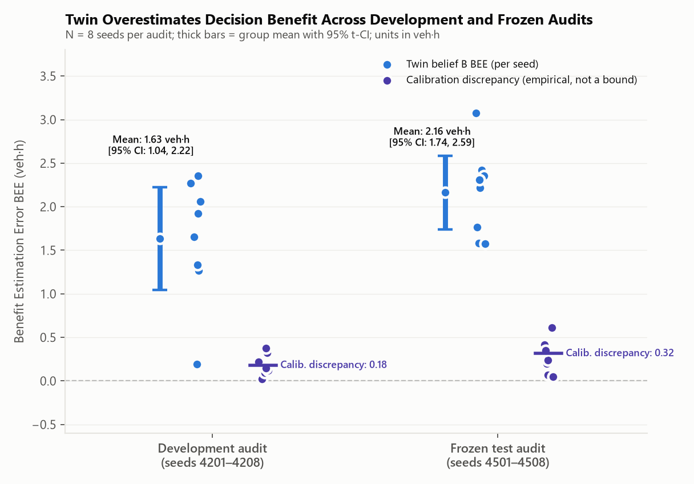
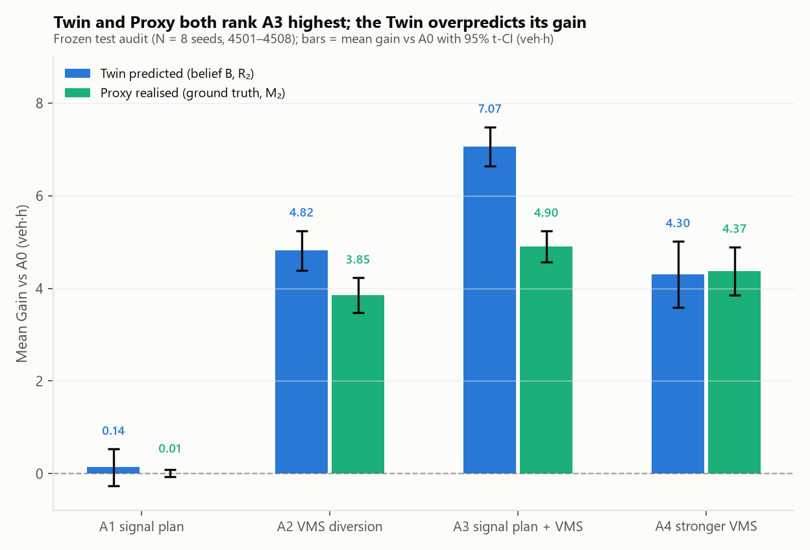
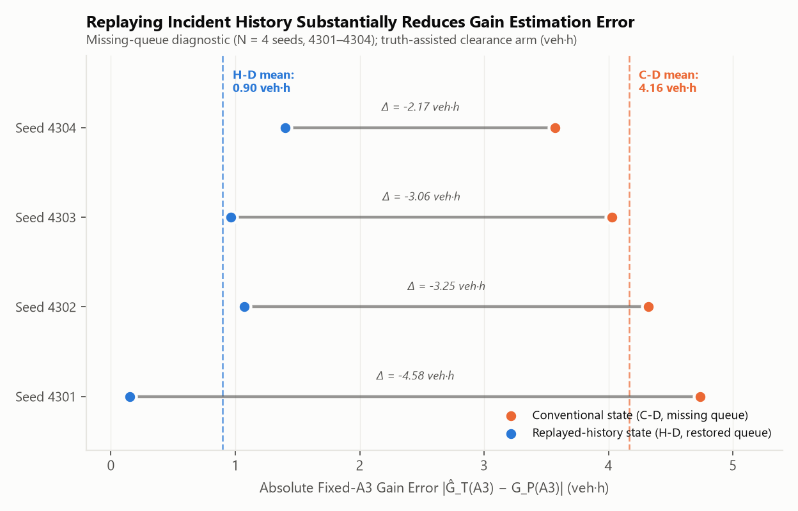

# 《城脉·涟控》作品说明书

**面向突发事件与模型失配的事件感知交通数字孪生（实验室原型）**

> 证据边界：本说明书中的实验数值分别来自冻结测试审计（设计冻结后只运行一次）、开发审计、预注册诊断实验和事件引擎开发运行，各组独立报告，从不合并。场景为合成的研究走廊，结论只适用于该场景，不代表真实道路效果。

---

## 一、立项依据

### 1.1 问题：需求同化可能掩盖事故失配

数字孪生要与现实保持同步，常规做法是用检测器残差持续校正模型参数，最常见的是入口需求。这种做法默认孪生与现实的差异来自缓慢变化的需求偏差。

**突发事故可能打破这一默认。** 某路段通行能力骤降后：
- 上游开始排队，下游放行流量下降；
- 只看下游检测器时，"流量下降"既可能意味着需求减少，也可能意味着通行能力损失，两者无法区分；
- 孪生若照常校正需求，可能把下游流量下降解释为需求减少，局部残差暂时变小，看起来"同步良好"；
- 但孪生中的道路通行能力仍是正常值，可能遗漏事故造成的排队历史；因此动作选择与收益预测是否可信，需要分别审计。

**更普遍的问题在于结构性失配。** 现实交通系统与其孪生在驾驶行为、需求生成方式、事故形态上本来就不同。孪生预测的"某干预能减少多少延误"，在现实中是否成立，需要独立的检验办法。真实道路只能观察到一条轨迹，无法得到"不干预会怎样"的对照。因此本项目在一个与孪生刻意不同的隐藏代理世界中做受控检验。

### 1.2 相关工作

- **基于模型的事故检测：** 已有长期研究，例如 Willsky 等（1980）的动态模型检测方法。
- **宏观交通状态与参数估计：** Wang 与 Papageorgiou（2005）提出了扩展卡尔曼滤波的通用框架。
- **商业实时仿真平台：** PTV Optima、Aimsun Live 等已经提供滚动预测与方案评估。
- **决策质量评价：** 用遗憾（regret）评价"预测—优化"链条（Elmachtoub 与 Grigas）；按估计值择优会产生系统性高估，即"优化者诅咒"（Smith 与 Winkler，2006）。
- **仿真比较：** 公共随机数配对是降低比较方差的标准方法。

**本项目的位置：**
- 不声称首创事故检测、实时仿真评估或遗憾指标；
- 关注上述方法在微观仿真孪生的闭环中，如何显式处理"需求与通行能力的混淆"；
- 关注在结构失配下，孪生的干预建议还可信到什么程度。

### 1.3 场景与数据

场景是一条按香港九龙东观塘道—观塘绕道形状构建的简化研究走廊：
- **路网几何、检测器编号、车道数和检测器间距**取自香港运输署公开的策略性主要道路交通数据（30 秒、分车道）；
- **需求为情景设定的边界条件**，不是标定结果；
- 用真实路网切片做需求标定的尝试没有通过预设门槛，这一负面结果已如实记录。

因此本作品是方法基准，不是观塘走廊的标定复制品。

---

## 二、项目创新内容

本项目只列三项创新。网页、消息总线、仿真调用等工程组件不算创新。每项创新都附可证伪的检验与实际结果。

### 创新 1：事件感知的双模同化（机制已实现并验证，推断能力未达成）

**内容**

| 环节 | 设计 |
|---|---|
| 常规模式 | 只做需求同化 |
| 触发 | 上下游检测器出现"上游拥堵、下游欠载"的背离 |
| 冻结 | 冻结受影响区域的需求更新，转入假设推断 |
| 假设库 | 20 个候选假设：10 个事故（3 个位置 × 封闭车道数 × 限速系数）、4 个需求阶跃、6 个检测器故障 |
| 评分 | 从快照回溯重放；残差聚合到 2 分钟块，在相同支持集上计算似然 |
| 状态机 | 正常、疑似事件、降级、事件同化、恢复；采纳事故假设后替换孪生状态，并检验何时解除 |

**检验结果**
- **机制层面：** 确定性重放、相同评分支持集、通行能力限制、观测防火墙都有记录在案的检验。
- **强制采纳：** 在强制采纳的开发运行中，状态替换、解除与恢复流程完整跑通。但 3/3 次主强制事件解除过早，4 次恢复过程中只有 1 次正常完成。
- **推断能力：** 在 6 个新的开发种子上，引擎触发了 13 次疑似事件，完成 25 次假设评估，**没有一次自然采纳事故假设（0/6）**。需求冲击与传感器卡死在正常读数的场景都没有触发报警，而且所注入冲击实际只带来 5–8% 的走廊流量增加。EVT 与 CONV 两臂的排队预测完全相同，未观察到预测改善。
- **离线回放诊断：** 把事故表示改为点封堵，并给出真实起始时刻后，假设"会被采纳"的评估从 0/13 增加到 6/13；9 次合成无事故评估全部保持否定。这些是相关的离线评估，不是控制器轨迹。

| 机制 | 证据层级 |
|---|---|
| 触发、假设库评估、排队预测 | 新开发运行中实际运行 |
| 采纳与状态替换、解除、恢复 | 仅强制采纳试验中运行 |
| 降级状态的定时退出 | 仅单元测试 |
| 需求冲击误报路径、检测器故障路径 | 未覆盖（未触发报警） |

结论：创新 1 的机制成立，但**可靠的事故推断没有实现**，按方案照实报告。

### 创新 2：结构失配下的反事实管控（在本场景中得到复现）

**内容：** 在决策时刻，孪生对 5 个基础设施级动作做配对反事实推演，按 15 分钟内的总通行时间择优。

| 动作 | 含义 |
|---|---|
| A0 | 无动作 |
| A1 | 事故信号预案 |
| A2 | VMS 诱导绕行 |
| A3 | 信号预案 + VMS |
| A4 | 加强 VMS |

动作语义在两个世界一致（信号程序、VMS 与按车辆的服从判定），孪生与代理世界之间不传递任何车辆编号或路径。

**检验结果**（冻结测试，8 个从未使用过的种子）：
- 孪生在 8/8 个种子上选择 A3，与代理世界事后最优动作一致 7/8；
- 决策遗憾 −0.03 车·时 [−0.11, 0.05]；
- 动作排序一致性 Spearman 0.825 [0.738, 0.912]；
- 同时，孪生对所选动作的收益**系统性高估**：收益估计误差 +2.16 车·时 [1.74, 2.59]。

### 创新 3：决策保真度审计协议（本作品的主要证据）

**内容：** 每个随机种子都在隐藏代理世界中执行同样的 5 个动作，得到"事后最优"。具体做法：
- 同一次重复内使用公共随机数；
- 用于选择与用于评估的重复仿真严格分开（孪生 R₁/R₂、代理 M₁/M₂）；
- 每个分支在独立进程中，从去除随机数状态的快照启动。

报告的指标：
- 收益估计误差：预测收益 − 实际收益；
- 决策遗憾；
- 排序一致性；
- 校准差异：用代理世界代替孪生重复同一流程，得到审计工具自身的蒙特卡洛噪声水平。

**流程保证：** 每个实验预注册，独立评审后才运行。开发与测试种子互不重叠。测试审计在设计冻结后只运行一次。冻结审计的核心指标从原始数据由三套独立实现复算：均值一致，部分区间末位存在舍入差异。

### 可行性与特色

- 全部组件基于开源微观仿真（SUMO 1.27.1）实现；
- 自动化测试 222 项通过；
- 冻结记录包含代码与资产哈希、运行环境和随机种子，结果可复现；
- 特色在于"如实"：负面结果（事故推断未达成、收益被高估）与正面结果同等报告，并用诊断实验解释其来源（见第三部分 3.6）。

---

## 三、实施方案

### 3.1 系统架构与信息防火墙

系统分为三个环，彼此之间只有规定的数据通道：

| 环 | 内容 | 数据通道 |
|---|---|---|
| 代理世界 | 隐藏的"现实" | 只经传感器模拟器向孪生发出检测器消息：30 秒流量、速度、占有率，有效标志，带噪声并丢包 |
| 在线环 | 孪生、同化、事件推断、反事实推演 | 只接收传感器消息 |
| 离线审计环 | 读取两个世界的保存状态 | 实验结束后才计算，结果不回流在线环 |

### 3.2 结构失配设计

| 维度 | 代理世界（现实） | 孪生 |
|---|---|---|
| 驾驶模型 | IDM | Krauss |
| 需求生成 | 路径文件 | 泊松稀疏化候选流，TKO 入口基准系数 0.85，常规同化 |
| 事故 | `ktb_n1` 900 米处两条车道封闭 15 分钟 | 未知，需推断或假设 |
| VMS 服从率 | 0.35（隐藏真值） | 0.30（假设值） |
| 观测 | 完整状态 | 14/21 个检测器，带噪声，5% 丢包 |

### 3.3 事件推断与状态机

**触发：** 上下游检测器对的背离指数连续两个 30 秒区间 ≥ 3。

**推断：**
- 起始时刻估计为报警时刻前 600 秒；
- 各假设从该时刻前 60 秒的快照，在独立进程中重放；
- 后验 ∝ 先验 × exp(0.25 × 对数似然)，温度系数未标定。

**状态转移：**
- 仅当全库最大后验假设属于事故族，且其对数后验减去需求族最高对数后验 > ln 10 时，才采纳事故假设并替换孪生状态；
- 需求族概率连续两次 > 0.6 判为误报；
- 判为检测器故障时下调该检测器权重；
- 无法解释的异常进入降级状态，900 秒后退出；
- 解除概率连续两次 > 0.7 时解除事故，进入恢复状态。

### 3.4 决策推演与审计统计协议

- **决策设置：** 决策时刻 t_d = 5,100 秒；评估时域 900 秒；指标为总通行时间（车·时，含等待进入路网的车辆）。
- **孪生的事故信念**（审计主条件）：在检测路段中点（755.3 米）两条车道点封堵，并持续到时域结束。
- **真值辅助对照**：同样的封堵在真实时刻 5,400 秒解除，记为 D300。
- **重复仿真：** 孪生 6 次，1–3 选择、4–6 评估；代理 6 次，1–3 定最优、4–6 评估；校准 6 次。
- **统计：** 跨种子构造 95% t 置信区间，自助法仅作核对。

### 3.5 冻结测试结果

设计于 2026-10-06 冻结，冻结记录包含代码哈希、配置、运行环境、动作定义、阈值与测试种子。测试审计在 8 个从未使用过的种子（4501–4508）上只运行一次。运行完整性：
- 960/960 个分支全部成功，无重跑、无重复、无剔除；
- 随机数隔离检验通过；
- 运行前后代码哈希一致。

图 1　收益估计误差（孪生预测收益 − 代理世界实际收益），开发审计与冻结测试各 8 个种子；紫色点为审计工具自身的校准差异

| 指标 | 冻结测试（4501–4508） | 开发审计（4201–4208） |
|---|---|---|
| 孪生所选动作 | A3：8/8 | A3：8/8 |
| 与事后最优一致 | 7/8 | 7/8 |
| 收益估计误差（车·时） | +2.16 [1.74, 2.59] | +1.63 [1.04, 2.22] |
| 决策遗憾（车·时） | −0.03 [−0.11, 0.05] | 0.03 [−0.04, 0.10] |
| 排序一致性 Spearman | 0.825 | 0.850 |
| 校准差异（车·时） | 0.32 [0.13, 0.50] | 0.18 [0.08, 0.28] |
| 固定动作 A3：孪生预测收益 / 代理世界实现收益 | 7.07 / 4.90 | 6.76 / 5.13 |
| 真值辅助对照 D300 的收益估计误差 | −2.87 [−4.91, −0.83] | −3.19 [−5.47, −0.90] |

冻结测试**复现了开发审计在本场景中的规律**：选择 A3、7/8 一致、收益被高估、排序强正相关、遗憾接近零。冻结测试中较大的点估计（+2.16 对 +1.63，0.32 对 0.18）不能确定两组之间存在差异，也不能确定两组相等。两组数据始终分列，不合并。

图 2　冻结测试中各动作相对无动作的平均收益：孪生预测与代理世界实际

### 3.6 诊断：为什么决策一致而收益偏高

**决策时刻的状态差异。** 代理世界的事故走廊上有 7–24 辆停驶车辆，`ktb_n1` 路段上有 161–194 辆车；孪生中停驶车辆为 0，该路段只有 26–43 辆车。孪生在决策时刻**缺少事故已经造成的排队历史**。

**缺失排队诊断**（预注册，4 个种子，720/720 个分支）：
- 把事故历史回放进孪生后，在真实解除时刻下，A3 收益的绝对误差从 4.16 降到 0.90 车·时，4 个种子全部改善；
- 孪生对"封堵会持续多久"的敏感度从 6.0–7.7 降到 1.4–3.0；
- 完整的动作排序没有改善；
- 按预注册的判定顺序，结论为"支持"。

**我们的解释（是解释，不是已证明的结论）：** 冻结结果与"误差相互抵消"一致——孪生假设封堵持续，这部分抵消了它缺失的事故历史；决策一致与收益准确可以背离。

图 3　缺失排队诊断：回放事故历史前后的 A3 收益绝对误差

### 3.7 局限

- 单一合成走廊、单一事故类型、单一决策时刻和动作集，测试种子 8 个。
- 审计中孪生的事故信念是**给定**的，不是在线推断得到的。
- 事件引擎没有自然采纳事故假设；在新的开发运行中，解除、恢复与降级退出都没有实际运行覆盖；降级退出只有单元测试证据。
- 常规同化未通过资格检验；温度系数与阈值未标定。
- 缺失排队诊断只有 4 个种子，属于描述性证据；回放事故历史改变的是整个继承状态，不只是排队。
- 决策遗憾的对照是在 M₁ 上选出、在 M₂ 上评估的最优动作；负的遗憾不代表孪生优于真正的最优。
- 校准差异是经验性的噪声水平，不是证明过的下界，不从收益估计误差中扣除。
- 种子 4503 的报警至决策时间只有 90 秒，低于预设的 120 秒余量；决策时刻仍按预注册固定在 5,100 秒。

---

## 四、应用前景

以下是待验证的应用设想。本原型目前仅在单一合成场景、给定事故信念下验证了决策保真度审计协议；用于其他系统、以及在线事故推断，都需要独立验证。

**设想路径（待验证）：**
1. 作为离线审计服务，评估既有孪生在事故情景下的动作选择与收益预测；
2. 在人在回路的前提下，把事件推断作为辅助提示接入；
3. 积累真实数据后，用"差中差"等准实验方法评估实际效果。

本作品目前是实验室验证级原型。可靠的事故推断、真实道路效果与可部署性都有待后续工作验证，我们不对此作出承诺。

---

## 参考文献

1. Willsky, A. S., et al. (1980). Dynamic model-based techniques for the detection of incidents on freeways. *IEEE Transactions on Automatic Control*, AC-25(3), 347–360.
2. Wang, Y., & Papageorgiou, M. (2005). Real-time freeway traffic state estimation based on extended Kalman filter: a general approach. *Transportation Research Part B*, 39, 141–167.
3. Elmachtoub, A. N., & Grigas, P. Smart "Predict, then Optimize". https://optimization-online.org/2017/12/6398/
4. Smith, J. E., & Winkler, R. L. (2006). The Optimizer's Curse. *Management Science*, 52(3), 311–322.
5. PTV Optima, York deployment. https://www.ptvgroup.com/en/resources/news/products/ptv-optima-extension-york-tackles-traffic-real-time-signal-optimization
6. 香港运输署，策略性/主要道路交通数据。https://data.gov.hk/en-data/dataset/hk-td-sm_4-traffic-data-strategic-major-roads
7. SUMO 文档：仿真状态保存与加载。https://sumo.dlr.de/docs/Simulation/SaveAndLoad.html
8. 公共随机数配对比较（WSC 2015）。https://www.informs-sim.org/wsc15papers/186.pdf
